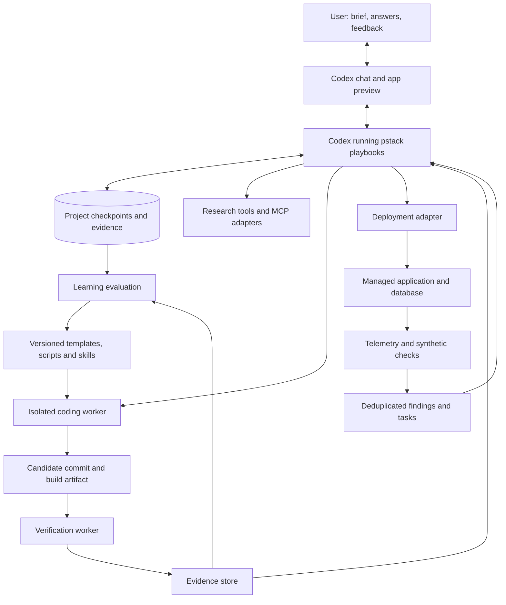

# Autonomous MVP Factory

Architecture and implementation plan, plus the first deployable MVP. Drafted 2026-10-25 for Russell's hackathon workflow. The full autonomous factory remains proposed; Closet Compass and its initial deployment package are implemented but not deployed.

## First factory project

The first working project is [Closet Compass](./apps/wardrobe-advisor/README.md), a mobile-first wardrobe assistant. Its thin vertical slice is:

1. Take or select a wardrobe photo on a phone.
2. Send the image to a server-side vision endpoint.
3. Review and correct the visible clothing inventory.
4. Explain the visible style and three useful wardrobe gaps.
5. Open current Australian shopping searches for those pieces.

The interface and deployment package are implemented. Live photo analysis still requires an `OPENAI_API_KEY` configured as a server-side secret; the project exposes a clearly labelled demo path when the secret is absent. This preserves an honest, testable journey without embedding credentials or fabricating analysis of the user's photo.

## Foundation decision

Use the installed open-source `pstack-for-codex` plugin as the workflow foundation, running inside Codex. Do not introduce OpenHands, Deep Agents or a separate agent framework for the first version. Start with the existing chat interface and pstack playbooks, then add small deterministic helpers where a repeated operation needs enforcement or reuse.

The first milestone is a complete MVP built through pstack with recorded acceptance criteria and repeatable verification. A custom dashboard, scheduler and distributed worker platform are deferred until actual runs demonstrate a need. The architecture below describes the eventual capabilities; it does not require building every box before the first hackathon.

Open-source workflow code does not eliminate inference or hosting costs. A running Codex task can perform the workflow; installation alone does not establish an always-on monitoring or repair service.

## Objective and scope

Turn a product brief into a deployed, demonstrable MVP; accept feedback during development; verify real user journeys; diagnose failures using runtime evidence; retain useful tools and preferences for the next hackathon.

Optimize for time to the first successful deployed user journey, demo reliability, and total human effort. Generating more code or closing more tickets is not success. A perfectly autonomous run that misses the judging criteria is a failed run.

First version supports one web product at a time, one standard stack, one hosting provider and one coding-agent adapter. Broader platform support comes after completing and measuring this loop. Research, coding, testing, deployment and learning are logical roles; they need not each be a permanent agent or microservice.

## Architecture



Codex running pstack proposes plans, patches, hypotheses and questions. Deterministic helpers will own operations that need enforced state transitions, resource limits or artifact identity. Initially, persist the brief, backlog, decisions and evidence in project files. Resumption means reading these checkpoints and reconciling them with the repository and provider state; it is not automatic replay of every interrupted action.

If unattended scheduled runs become necessary, add a small runner and SQLite operation ledger around the proven workflow. Build that only after a complete interactive run works. A hosted app can stay online while Codex is offline; monitoring-triggered repair needs an explicitly configured running service or supported scheduled task. File checkpoints alone provide neither scheduling nor hard budget enforcement.

## Default product stack and hosting

The implemented first stack is Next.js/TypeScript in a portable Docker image, Render for the application, and Supabase for optional Postgres/auth/storage. Add a Python/FastAPI service or background worker only when a product needs Python libraries or asynchronous processing. Pin dependencies in the template and refresh deliberately between runs.

Use Render as the initial managed deployment target. The root `render.yaml` describes Closet Compass as a free Docker web service; the app exposes `/api/health`, includes a remote smoke test and can move to another OCI-compatible host later. Supabase configuration and migrations live with the app but no database is provisioned for the current stateless journey. Provider resources remain separate: Render's Blueprint does not create the Supabase project.

The cost policy starts at USD 0 on free plans, targets no more than USD 7/month for an always-on application, and requires approval above USD 10/month, for an additional database project, or for any GPU. Preview environments expire after 48 hours. These values are recorded in `apps/wardrobe-advisor/factory.project.yaml`; until a runner enforces them, configure provider alerts and perform the cleanup checklist manually. Prices and free-tier rules must be checked at deployment time.

The deployment adapter implements inspect, plan, apply, status, smoke-test and rollback operations. Blueprints and provider APIs are the initial implementation; Terraform can implement the same contract for another target later. Do not maintain two competing infrastructure definitions for the same resources. Docker packages the application; it does not provide deployment orchestration or a strong sandbox for arbitrary generated code by itself.

Render's documented capabilities: [Blueprints](https://render.com/docs/infrastructure-as-code), [Blueprint schema](https://render.com/docs/blueprint-spec), [API](https://render.com/docs/api). Terraform supports [saved plans](https://developer.hashicorp.com/terraform/cli/commands/plan) if a Terraform adapter is added.

## Run contract

Before a run, persist the following configuration:

| Field | Purpose |
| --- | --- |
| Brief, target users, judging rubric | Establish product value and mandatory requirements |
| Demo journey and acceptance criteria | Define what must be demonstrable |
| Deadline and freeze time | Reserve time for stabilization and the presentation |
| Model budget, cloud budget, wall-time budget | Bound expenditure and iteration |
| Allowed repositories, provider project and tool scopes | Define where actions may occur |
| Deployment policy and resource limits | Allow routine preview releases within explicit bounds |
| Question policy and user availability | Decide what waits and what can use a stated default |
| Template and skill versions | Make execution reproducible |
| Stop and cleanup policy | End the run and identify remaining billable resources |

Configuration is an executable contract. Workers cannot increase their own budgets, change protected acceptance criteria, or expand provider scope. A user can preauthorize bounded resource creation and deployment at run setup; the system does not need a fresh question for every routine release within that scope. Out-of-scope actions become a specific pending decision.

## Three loops at different speeds

### Product and delivery loop

1. Capture the brief and hackathon rubric. Identify a single compelling demo journey.
2. Research only decisions that affect that journey: available APIs, current feature capabilities, authentication, limits and dependencies. Store URL, retrieval time, claim, version and uncertainty. A marketing claim is not integration evidence; test crucial APIs early.
3. Create a small backlog with acceptance criteria, dependencies and effort estimates. Prioritize demo value and unblockers.
4. Scaffold from the versioned template and deploy a thin vertical slice early: UI action, API, persisted data, visible result.
5. Implement the highest-value ready task in an isolated workspace. Provide the worker with the relevant brief, decisions, code and prior failure evidence.
6. Build and verify the candidate artifact. Diagnose failures; retry within limits.
7. Deploy the verified artifact, run the actual remote demo journey, and show the user a preview.
8. Incorporate user feedback, reprioritize, and continue until the target is met, budget expires or the freeze starts.

Use events for user replies and provider callbacks where possible. Poll only services without usable event delivery, at a bounded interval with backoff. Keep the question inbox available throughout the run, but do not continuously interrupt the user with duplicate or low-value questions.

Each question records its task, reason, choices, default if allowed, impact and response state. Questions about credentials or necessary permissions block the dependent action. Reversible preferences can use a stated default after the configured deadline. Silence never grants new permission. Answers superseding previous decisions invalidate affected plans and checks; unrelated work continues.

### Runtime improvement loop

Collect application errors, latency, failures in synthetic user journeys and infrastructure saturation. Emit structured logs and OpenTelemetry spans with release identity. Use one observability destination with a query API; confirm actual query access during setup. Instrumentation without a readable backend does not give the agent monitoring capability.

Rules detect sustained failures and create findings. Group by project, environment, symptom and affected component; attach release, time window, sample count, trace/log references and reproduction. Update an existing issue rather than opening a new issue for every sample. Apply cooldowns and retry ceilings. At low hackathon traffic, synthetic journeys are more useful than unstable percentile estimates from a handful of requests.

The model investigates a finding and proposes a task. Only tasks that threaten the demo or meet the configured priority threshold enter the active backlog. Performance improvements need a repeatable measurement and a before/after comparison under comparable conditions. A slow cold start is not automatically a database problem. Stop new feature work at freeze time; allow only fixes necessary for the demo, then return to monitoring.

Monitor the factory separately: queue age, worker heartbeats, retries, stuck decisions, model usage, elapsed time and deployment ambiguity. A factory crash must not be mistaken for a healthy product.

OpenTelemetry provides [traces, metrics and logs](https://opentelemetry.io/docs/). Render documents [service metrics](https://render.com/docs/service-metrics), [metric streaming](https://render.com/docs/metrics-streams) and [log streaming](https://render.com/docs/log-streams); availability and plan requirements must be checked during setup.

### Learning loop between runs

Use supported transcript exports or the factory's own event log, user corrections, diffs and verification results. Separate explicit user preferences from inferred lessons. Distinguish a tool failure, a wrong assumption, a weak requirement and a code defect before proposing a change.

Produce one of three artifacts:

- A preference record, such as preferred language or how often to ask questions, with evidence and scope.
- A skill for contextual judgment, such as diagnosing a failed deployment.
- A deterministic script or template for repeatable operations, such as schema initialization or health checking.

Candidate changes live in a separate versioned branch. Run syntax checks, regression tests and representative tasks from previous runs. Compare completion, correctness, cost and human interruptions against the existing version. Promote only demonstrated improvements; retain rollback. Do not let one noisy run rewrite global preferences. Do not carry secrets, proprietary project data or raw user transcripts into reusable artifacts. The active run retains its pinned skill version; learning updates normally take effect next run.

## Durable records and failure handling

Core records: Project, Run, BriefRevision, Decision, Question, Task, Attempt, ToolOperation, Artifact, Verification, Deployment, Finding, Resource and LearningCandidate. Every record is project-scoped. Events have stable IDs and carry causation and correlation IDs.

Task states: proposed -> ready -> running -> verifying -> done. Additional states: blocked, retryable-failure, failed, cancelled. Deployment has its own state because verified code may fail to deploy. A worker's claim of completion is not sufficient to mark the task done.

Every attempt records input hashes, base commit, skill version, owner, lease expiry, budget allocation, output artifact hash and evidence. A heartbeat renews the lease. A fencing token prevents an expired worker from committing state after a replacement begins. Give parallel writers separate worktrees or exclusive paths; merge through one integration owner and rerun checks after integration.

For external operations, write intent before execution, record the provider ID and reconcile afterward. Use stable idempotency keys where supported. If a request times out after a provider may have created a resource, mark it unknown and query the provider before retrying. Exactly-once effects are not supplied by the job queue. Crash recovery must distinguish an operation never started from one whose result was lost.

Provider credentials remain in the trusted execution layer. Generated app code gets only its own application credentials. Worker isolation uses per-run filesystem and process boundaries, constrained credentials and restricted egress; production cloud workers need a stronger isolation design than a shared developer shell.

## Verification and release contract

Each task names observable acceptance criteria before implementation. Verification combines unit/integration tests with the actual UI or API journey. Capture relevant outputs, screenshots, database side effects and failed assertions. Do not accept edited-away assertions as a fix. Use separate verification context for material changes, even if workers run sequentially.

Bind evidence to the candidate commit, dependency locks, container digest, environment and acceptance-criteria revision. Deploy that tested digest, or verify that the provider rebuilt exactly the tested source and run remote checks. Prevent deployment races and stale workers from promoting an older release.

Database migrations are serialized and tested on a fresh database and a previous supported schema. Prefer additive migrations during a hackathon. Application rollback is safe only when the older code is compatible with the new schema; otherwise use a forward repair. Seed synthetic demo data, verify persistence after restart, and verify one failure path as well as the happy path.

## How to use pstack

Start a new Codex task after installation so the skill catalogue is refreshed. Invoke skills explicitly with `$skill-name` in the chat. The following is a proposed first-run prompt, not a command that has already been executed:

```text
$poteto-mode Build an event-registration MVP in the specified target repository.
Use the hackathon brief and acceptance criteria as the source of truth.
Research required integrations, scaffold from our template, and implement
the browse-events -> register -> persisted-confirmation journey.
Ask focused questions when necessary and continue independent work.
Record decisions and evidence. Verify the real UI and database behaviour.
Prepare deployment and report any missing account configuration.
Finish with a reproducible demo and a checkpoint another task can resume.
```

Use `$poteto-help` for workflow guidance. After an app runs, `$create-verification-skill` can generate its reusable verification instructions; `$maintain-verification-skill` can maintain those as features change. Use the installed workflow's available capabilities and report gaps. Reinvoke `$poteto-mode` for later tasks rather than assuming persistent mode activation without evidence from its hooks.

## What pstack contributes

Use pstack inside the coding and verification activities: investigation, architecture review, implementation discipline, TDD and reusable verification instructions. The installed create-verification-skill workflow explicitly generates project-specific launch, health, interaction, evidence and cleanup instructions and requires exercising them.

Pstack is not the durable scheduler, resource ledger, deployment provider, monitoring backend or learning evaluation service. Its prompts cannot enforce budgets or prevent duplicate provisioning on their own. Those belong in code. Model and tool support must be discovered at execution time; missing tools produce an explicit degraded or blocked result.

Sources: [pstack guide](https://github.com/Aqua-123/pstack-for-codex/blob/main/docs/guide/README.md), [adaptation limits](https://github.com/Aqua-123/pstack-for-codex/blob/main/docs/codex-adaptation.md), [verification generator](https://github.com/Aqua-123/pstack-for-codex/blob/main/skills/create-verification-skill/SKILL.md).

## Implementation sequence and exit criteria

| Stage | Deliverable | Demonstration required |
| --- | --- | --- |
| 1. One complete build | Pstack workflow, app template, file checkpoints and local verification | A brief produces a working UI/API/database journey; a fresh task resumes from recorded state and live checks |
| 2. Managed release | Render adapter, resource ledger, migrations, release identity and remote smoke test | Deploy the tested candidate; simulate a lost provider response without duplicating resources |
| 3. User steering | Codex chat, app preview, recorded questions and decisions | Answer a question mid-run; revise the brief; obsolete work is invalidated and unrelated work continues |
| 4. Runtime repair | Readable telemetry, synthetic checks and deduplicated findings | Inject a test-environment defect; produce one finding, reproduce it, fix it and verify recovery |
| 5. Reusable learning | Transcript/event analysis, script/skill candidates and evaluation fixtures | Reuse a promoted helper in a different MVP and show that it saves work without breaking old tasks |
| 6. Throughput | Isolated parallel workers and integration queue | Two independent features merge and pass combined checks without shared-file corruption |

Start with a simple event-registration MVP: browse events, register, persist the registration and view a confirmation. It tests forms, validation, data access and deployment without requiring real payments. Then try a structurally different MVP to expose overfitting in templates and learned skills.

Proposed first benchmark, not a performance claim: one bounded MVP brief, a fixed model budget and a two-hour wall-time cap. Track time to deployed happy path, verified acceptance coverage, manual interventions, cost, recovery after coordinator restart and demo success. Record research and infrastructure time separately so the next improvement targets the actual bottleneck.

## Suggested repository layout

```text
factory/
  runner/            # Deferred: unattended execution and operation ledger
  adapters/          # Hosting and telemetry helpers as needed
  playbooks/         # Hackathon workflow integrating installed pstack
  contracts/         # Typed records and operation/result schemas
  templates/         # Versioned MVP starters
  skills/            # Reviewed reusable workflows
  scripts/           # Deterministic helpers with contracts and tests
  evaluations/       # Fixed briefs, acceptance checks and regression fixtures
  tests/             # Recovery, integration and release tests
```

Runtime state, credentials and project output live outside the reusable source tree. Generated app repositories have independent version histories. External issue trackers are optional mirrors of factory tasks; the local task store remains sufficient for the first version.

## Outstanding configuration for implementation

The user selected pstack-for-codex, Render and Supabase. Closet Compass now has a Dockerfile, Render Blueprint, health endpoint, smoke test, Supabase migration directory and explicit cost policy. No cloud resources have been created: deployment still requires a Git remote, a Render account/project and an OpenAI API key for live analysis. A Supabase project is intentionally deferred until the app gains a persistence requirement. Provider budget alerts, telemetry query access and automated preview cleanup remain implementation work.
