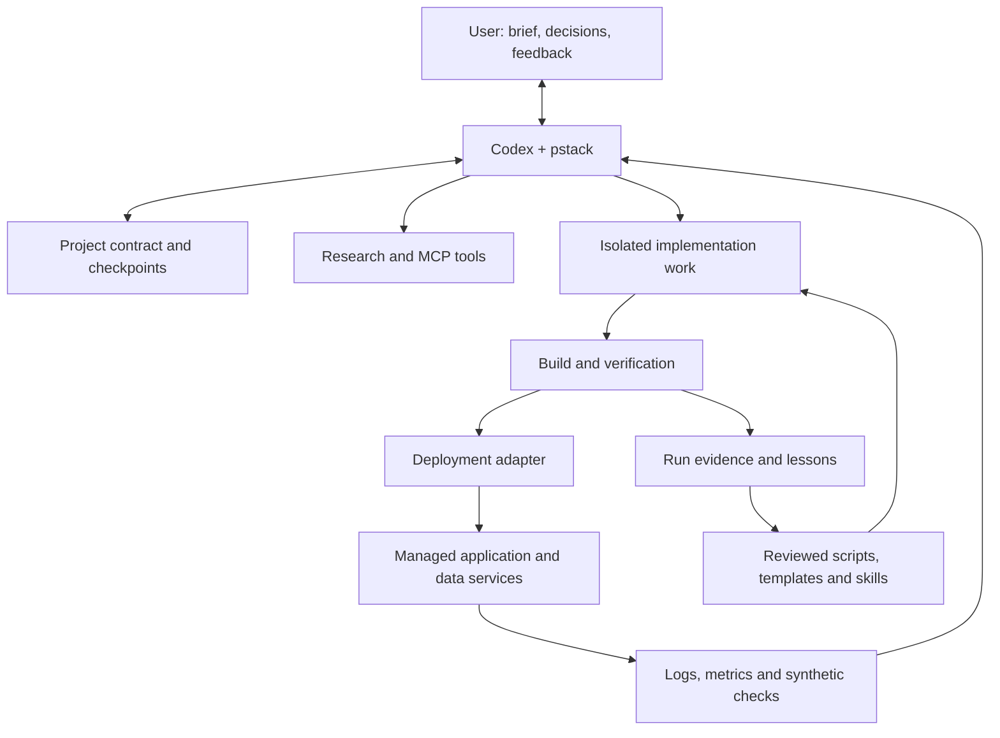

# Factory architecture

## Objective

Turn a product brief into a deployed, demonstrable MVP; accept user steering during development; verify real user journeys; diagnose failures with runtime evidence; and retain proven improvements for later hackathons.

Success is time to a reliable demo and acceptance-criteria coverage—not generated code volume, agent count or tickets closed.

## System boundary

Codex and pstack provide investigation and engineering judgment. Deterministic helpers own repeatable operations such as project initialization, validation, migrations, smoke tests and provider reconciliation. Project files are the durable handoff between agents; chat history is useful evidence but not the system of record.

## Default deployment shape

The implemented first stack is Next.js/TypeScript in a portable Docker image, Render for the web application and Supabase only when Postgres, authentication or object storage is genuinely required. A Python/FastAPI service or worker is added only for a Python-specific or asynchronous workload.

Each deployable project should expose a health endpoint and a remote smoke test. The tested container or source commit must match the deployed release. Application rollback is safe only when its database schema remains compatible.

## Durable records

The lightweight version stores these concepts in project files and Git:

- brief and acceptance criteria;
- decisions and unresolved questions;
- tasks and current checkpoint;
- attempts and verification evidence;
- deployments and external resource identifiers;
- lessons and promotion candidates.

If unattended execution becomes necessary, add a runner with an operation ledger. External mutations should record intent before execution, provider identity afterward and an `unknown` state when a response may have been lost. Reconcile provider state before retrying.

## Future factory services

Add scheduling, parallel workers, centralized telemetry and automatic issue creation only after repeated interactive runs show a concrete need. Logical research, implementation and verification roles do not require permanent microservices or one agent per role.
