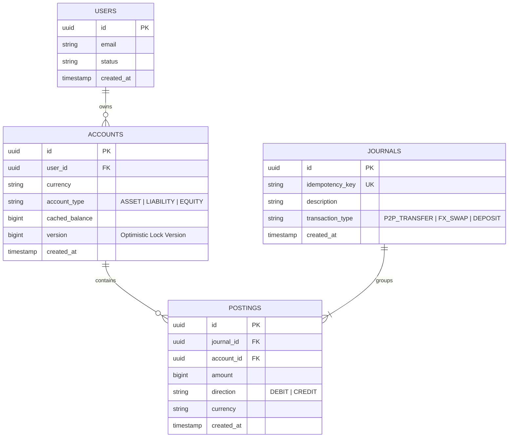

# Spec 2.1: Multi-Currency Digital Wallet & Double-Entry Ledger

## 1. System Objective
Design a multi-currency wallet engine and immutable double-entry ledger platform capable of managing user balances across multiple fiat currencies (USD, SGD, EUR, AUD), executing atomic peer-to-peer (P2P) transfers and cross-currency FX swaps, and ensuring strict accounting integrity with zero balance leakage ($\sum \text{Debits} \equiv \sum \text{Credits}$).

## 2. System Requirements

### Functional Requirements
* **Multi-Currency Balances**: Isolated accounts per asset type (`USD`, `SGD`, `EUR`, `AUD`) per user.
* **Atomic Transfers**: Peer-to-peer transfers between users (e.g. User A sends 100.00 USD to User B).
* **Internal Currency FX Swaps**: Atomic swap converting 100.00 USD to 135.00 SGD within User A's wallet.
* **Audit & Export**: Full point-in-time balance query and immutable transaction history extraction.

### Non-Functional Requirements
* **Consistency**: Strict Serializability / ACID guarantees. No ghost money, zero double-spending, balances cannot become negative unless explicitly configured with an overdraft facility.
* **Auditability**: Immutable double-entry bookkeeping. Every financial event consists of a `Journal` containing at least two balanced `Posting` legs ($\sum \text{Debit} = \sum \text{Credit}$).
* **Throughput & Latency**: $10{,}000\text{ write TPS}$ at peak hours; P99 latency $< 50\text{ ms}$.

## 3. Scaling & Capacity Estimation

### User Load Model
| Metric | Value | Rationale |
| :--- | :--- | :--- |
| Registered users | 10M | Mature fintech (Wise, Revolut scale) |
| DAU | 1M (10% of registered) | Standard fintech engagement ratio |
| Avg transactions per DAU | 3–5 | Mix of P2P, top-ups, FX swaps |
| Peak TPS (sustained) | 10,000 | 2–3× average during salary days, promotions |
| Burst TPS (spike) | 30,000 | Flash sales, year-end settlement windows |
| Posting rows per txn | 2–4 (P2P=2, FX swap=4) | Double-entry legs per journal |
| Posting write rate | 20,000–40,000 rows/sec at peak | Directly proportional to TPS |

### Storage Estimation
| Entity | Daily Growth | Monthly Growth | Retention |
| :--- | :--- | :--- | :--- |
| Journal rows | ~5M/day | ~150M/month | Indefinite (immutable audit log) |
| Posting rows | ~15M/day | ~450M/month | Indefinite |
| Account rows | Slow growth | Proportional to new user signups | Indefinite |
| Storage per posting row | ~120 bytes (UUID + UUID + bigint + enum + currency + timestamp) | | |
| **Hot data (90 days combined)** | | **~1.8B rows ≈ ~300 GB** | 207GB raw data + ~100GB B-Tree indexes |
| **Cold archive (>90 days)** | | Compressed Parquet in S3/GCS | 7-year regulatory retention |

### Database Scaling Strategy
* **Vertical first**: A single PostgreSQL 16 instance with 64 vCPUs, 256 GB RAM, NVMe SSDs handles ~15,000 write TPS.
* **Horizontal sharding trigger**: When write TPS > 15K or > 2B rows, shard by `account_id` using consistent hashing.

### Application Server Scaling
* **Target Load**: 10,000 peak TPS.
* **Server Capacity**: A standard 8-vCPU / 32 GB RAM node running Spring Boot + HikariCP handles ~3,000 TPS before being bottlenecked by its DB connection pool (30 connections per node handling 200 queries/sec each).
* **Servers needed**: $10,000 \text{ TPS} / 3,000 = 3.3 \text{ servers}$. 
* **Redundancy margin**: Apply 2× safe-headroom margin + N+1 redundancy: **Deploy 8–10 application nodes**.

### Read Scaling
* **Read replicas**: 2–3 async replicas for balance-read and audit-export queries.
* **CQRS projection**: Materialized `account_balance_snapshot` table updated by CDC (Debezium).

---

## 4. Database Schema & Double-Entry ERD

### Double-Entry Accounting Invariants
1. **Posting Rule**: An individual posting leg is either a `DEBIT` or a `CREDIT`.
2. **Journal Invariant**: For every journal entry $J$:
   $$\sum_{p \in \text{Postings}(J)} \text{amount}(p)_{\text{DEBIT}} = \sum_{p \in \text{Postings}(J)} \text{amount}(p)_{\text{CREDIT}}$$
3. **Account Balance Rule**: $\text{Balance} = \sum \text{Credits} - \sum \text{Debits}$ (or vice versa based on Asset vs Liability classification).

### ERD Diagram (Mermaid)



### Schema Design Decisions & Tradeoffs

| Decision | Choice | Alternative Considered | Why This Way |
| :--- | :--- | :--- | :--- |
| **Balance representation** | `bigint` (cents/minor units) | `DECIMAL(19,4)` / `BigDecimal` | `bigint` eliminates floating-point drift entirely. 100.50 USD = `10050`. No rounding surprises across currencies with different minor-unit scales (JPY has 0 decimals, BHD has 3). Tradeoff: application must manage scale conversion. |
| **`cached_balance` on `ACCOUNTS`** | Denormalized running balance | Compute on-the-fly from `SUM(postings)` | At 450M postings/month, `SELECT SUM(amount) FROM postings WHERE account_id = ?` takes ~200ms on a cold scan even with B-tree indexes. The cached balance gives O(1) reads. Tradeoff: cached balance must be updated atomically within the same transaction as posting inserts, or it drifts. |
| **`version` column** | Optimistic locking fallback | Rely solely on `FOR UPDATE` pessimistic locks | Enables optimistic retry for read-heavy paths (balance checks without writes). The write path still uses pessimistic `FOR UPDATE` to guarantee ordering. |
| **Idempotency key on `JOURNALS`** | Unique constraint in DB | Redis-only idempotency cache | DB-level uniqueness survives Redis crashes. Redis is an optimization, not the source of truth. |
| **No `DELETE` operations** | Append-only / immutable | Allow soft deletes or reversals as updates | Financial regulations (SOX, MAS) require immutable audit trails. "Reversals" are new journals with inverted postings, never mutations of existing rows. |

### Balance Checkpointing & Recovery
If the `cached_balance` on the `ACCOUNTS` table gets corrupted or wiped out, running `SELECT SUM(amount) FROM postings` across 5 years of history is incredibly slow. To bound recovery time:
1. **The Snapshot Table:** A nightly cron job runs an aggregate query and writes a row to `account_balance_checkpoints` containing the exact balance as of 23:59:59 (e.g. `account_id: 123, closing_balance: 500, checkpoint_timestamp: 2026-08-31`).
2. **Swift Recovery:** If a balance drift is caught by the reconciliation worker, the system looks up the latest checkpoint, sums only the postings that occurred *after* that checkpoint datetime, and adds them to the checkpoint base balance. Recovery is guaranteed to take milliseconds (bounding the sum to a maximum of 24 hours of postings).

## 5. Component Architecture (Simple Box Diagram)

```text
       [ Mobile / Web Client ]
                 |
                 v (HTTPS POST)
[ AWS ALB Load Balancer (2 vCPU / 4 GB) ]
                 |
                 v (Route)
[ API Gateway (8 vCPU / 32 GB RAM) ]
                 |
                 v (JWT/Rate Limit)
[ Ledger Service (8 vCPU / 32 GB / 10 Gbps) ]
            /                  \
           / (Idem check)       \ (Write Tx)
          v                      v
[ Redis Cluster ]         [ PostgreSQL Primary ] --WAL--> [ PG Replicas ]
(3x 8 vCPU / 52 GB)       (16 vCPU / 128 GB RAM)          (16 vCPU / 128 GB)
(Disk: N/A - RAM)         (Disk: 1 TB io2 SSD)            (Disk: 500 GB gp3)
```

## 6. Step-by-Step Transaction Execution Lifecycle (Sequence)

```text
Client          API Gateway      Ledger Service           Database
  |                 |                  |                     |
  |-- 1. POST (~5ms) >|                |                     |
  |                 |-- 2. Route(~1ms)>|                     |
  |                 |                  |                     |
  |                 |                  |--- 3. BEGIN TX ---->|
  |                 |                  |--- 4. Idem Check -->| (Redis: ~0.3ms)
  |                 |                  |<- (Hit: Return 200)-|
  |                 |                  |                     |
  |                 |                  |--- 5. Lock Accts -->| (~2-5ms wait)
  |                 |                  |--- 6. INSERT Jnl -->| (~3-5ms for 
  |                 |                  |--- 7. INSERT Pst -->|  all inserts)
  |                 |                  |--- 8. UPDATE Bal -->| (~2-3ms)
  |                 |                  |--- 9. COMMIT TX --->| (~1-3ms fsync)
  |                 |                  |                     |
  |                 |<- 10. Success ---| (Total DB ~15-20ms) |
  |<- 11. 200 OK ---| (~2ms res/net)   |                     |
  |                 |                  |                     |
```
Total End-to-End Latency Target: **P99 < 50ms**

### Core Java Ledger Service Implementation

```java
package com.financial.ledger.service;

import java.math.BigInteger;
import java.util.*;
import org.springframework.stereotype.Service;
import org.springframework.transaction.annotation.Transactional;
import org.springframework.transaction.annotation.Isolation;

public record TransferCommand(
    String idempotencyKey,
    UUID senderAccountId,
    UUID receiverAccountId,
    BigInteger amount,
    String currency
) {}

@Service
public class LedgerService {

    private final AccountRepository accountRepository;
    private final JournalRepository journalRepository;
    private final PostingRepository postingRepository;

    public LedgerService(
            AccountRepository accountRepository, 
            JournalRepository journalRepository, 
            PostingRepository postingRepository) {
        this.accountRepository = accountRepository;
        this.journalRepository = journalRepository;
        this.postingRepository = postingRepository;
    }

    @Transactional(isolation = Isolation.READ_COMMITTED)
    public UUID transferFunds(TransferCommand cmd) {
        // Step 1: Check Idempotency
        Optional<JournalEntity> existingJournal = journalRepository.findByIdempotencyKey(cmd.idempotencyKey());
        if (existingJournal.isPresent()) {
            return existingJournal.get().getId();
        }

        // Step 2: Sort Account IDs to prevent deadlocks when locking
        List<UUID> accountIds = Arrays.asList(cmd.senderAccountId(), cmd.receiverAccountId());
        accountIds.sort(Comparator.comparing(UUID::toString));

        // Step 3: Lock Accounts Pessimistically in Order
        Map<UUID, AccountEntity> accountMap = new HashMap<>();
        for (UUID accId : accountIds) {
            AccountEntity acc = accountRepository.findAndLockById(accId)
                .orElseThrow(() -> new IllegalArgumentException("Account not found: " + accId));
            accountMap.put(accId, acc);
        }

        AccountEntity sender = accountMap.get(cmd.senderAccountId());
        AccountEntity receiver = accountMap.get(cmd.receiverAccountId());

        // Step 4: Business Validation
        if (sender.getCachedBalance().compareTo(cmd.amount()) < 0) {
            throw new IllegalStateException("Insufficient funds in account: " + sender.getId());
        }

        // Step 5: Record Journal & Double-Entry Postings
        JournalEntity journal = new JournalEntity();
        journal.setIdempotencyKey(cmd.idempotencyKey());
        journal.setTransactionType("P2P_TRANSFER");
        journal.setDescription("Transfer from " + sender.getId() + " to " + receiver.getId());
        journalRepository.save(journal);

        PostingEntity debitPosting = new PostingEntity(
            journal.getId(), sender.getId(), cmd.amount(), "DEBIT", cmd.currency());
        PostingEntity creditPosting = new PostingEntity(
            journal.getId(), receiver.getId(), cmd.amount(), "CREDIT", cmd.currency());
        postingRepository.saveAll(List.of(debitPosting, creditPosting));

        // Step 6: Update Cached Balances
        sender.setCachedBalance(sender.getCachedBalance().subtract(cmd.amount()));
        receiver.setCachedBalance(receiver.getCachedBalance().add(cmd.amount()));

        accountRepository.saveAll(List.of(sender, receiver));

        return journal.getId();
    }
}
```

## 7. Concurrency Isolation & Partitioning Strategy

### Concurrency Isolation Level Selection: Java / DB Layer
* **Selection**: `READ COMMITTED` with explicit deterministic pessimistic row locking (`findAndLockById` using `SELECT ... FOR UPDATE`).
* **Justification**:
  * Prevents application lock retry spikes caused by database serialization failures (`40001` in PostgreSQL).
  * Ordering `UUID` locks alphabetically in Java eliminates cross-account transaction deadlocks.

## 8. Failure Points & Recovery

### Failure Mode Analysis

| Failure Scenario | Impact | Detection | Recovery Strategy | RTO |
| :--- | :--- | :--- | :--- | :--- |
| **DB primary crash mid-transaction** | In-flight transactions rolled back automatically | Patroni/pg_auto_failover heartbeat miss (< 10s) | Automatic failover to synchronous standby. Uncommitted transactions retried by clients using idempotency keys. | < 30s |
| **`cached_balance` drift from postings** | Silent accounting error | Nightly reconciliation job | Auto-heal: overwrite `cached_balance` from posting aggregate. Alert on-call if drift count > 0. | 6h cycle |
| **Network partition between app & DB** | Connection timeout | HikariCP pool health checks | Circuit breaker (Resilience4j) opens. Pool reconnects when partition heals. | ~10–30s |
| **Hot account lock contention** | P99 latency > 500ms | DB lock wait time metrics | Split merchant account into N shards, round-robin incoming credits. | Config change |

## 9. Metrics, Tracing & Observability

### Key Business Metrics

| Metric | Alert Threshold | Why It Matters |
| :--- | :--- | :--- |
| `ledger.transfer.tps` | Spike > 2× baseline sustained | Capacity planning; early fraud detection |
| `ledger.transfer.latency_p99` | > 50ms for > 5min | SLA violation signal, often hides lock contention |
| `ledger.balance.drift_count` | > 0 | Accounting integrity violation (triggers P1 alert) |
| `db.lock_wait_time_ms` | P99 > 50ms | Hot account detection trigger |

### Distributed Tracing (OpenTelemetry)
Every transfer request carries a `traceId`. Critical span tags:
- `account.sender_id`, `account.receiver_id` — target for lock wait correlation
- `idempotency.cache_hit` — distinguish new vs replayed requests

---

## 10. Self-Evaluation Checklist
- [x] **Double-Entry Constraints**: Immutable schema with `JOURNALS` and `POSTINGS` balancing $\sum \text{Debits} = \sum \text{Credits}$.
- [x] **Java Service Implementation**: Idiomatic Spring/Java transaction execution service using `BigInteger` balance math.
- [x] **Concurrency Selection**: Pessimistic ordered row locking in Java (`ORDER BY accountId`) to eliminate deadlocks.
- [x] **Execution Lifecycle**: Complete step-by-step sequence diagram covering idempotency, locking, posting insertion, and balance updates.
