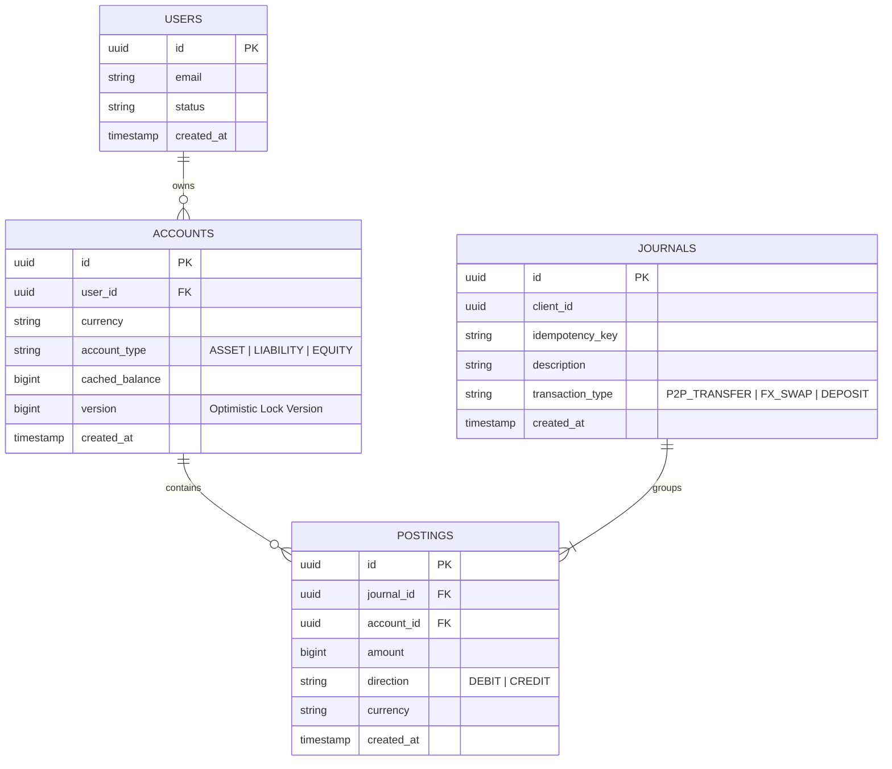

# Spec 2.1: Multi-Currency Digital Wallet & Double-Entry Ledger

## 1. System Objective
Design a multi-currency wallet engine and immutable double-entry ledger platform capable of managing user balances across multiple fiat currencies (USD, SGD, EUR, AUD), executing atomic peer-to-peer (P2P) transfers and cross-currency FX swaps, and ensuring strict accounting integrity with zero balance leakage ($\sum \text{Debits} \equiv \sum \text{Credits}$).

## 2. System Requirements

### Functional Requirements
* **Multi-Currency Balances**: Isolated accounts per asset type (`USD`, `SGD`, `EUR`, `AUD`) per user.
* **Atomic Transfers**: Peer-to-peer transfers between users (e.g. User A sends 100.00 USD to User B).
* **Internal Currency FX Swaps**: Atomic swap converting 100.00 USD to 135.00 SGD within User A's wallet.
* **Audit & Export**: Full point-in-time balance query and immutable transaction history extraction.

### Non-Functional Requirements
* **Consistency**: Strict Serializability / ACID guarantees. No ghost money, zero double-spending, balances cannot become negative unless explicitly configured with an overdraft facility.
* **Auditability**: Immutable double-entry bookkeeping. Every financial event consists of a `Journal` containing at least two balanced `Posting` legs ($\sum \text{Debit} = \sum \text{Credit}$).
* **Throughput & Latency**: $10{,}000\text{ write TPS}$ at peak hours; P99 latency $< 50\text{ ms}$.

## 3. Scaling & Capacity Estimation

### User Load Model
| Metric | Value | Rationale |
| :--- | :--- | :--- |
| Registered users | 10M | Mature fintech (Wise, Revolut scale) |
| DAU | 1M (10% of registered) | Standard fintech engagement ratio |
| Consumer wallet transactions | ~3M–5M/day | 1M DAU × 3–5 user-initiated actions/day |
| Platform ledger writes | ~300M–400M journals/day | Includes card auth/capture, merchant settlement, treasury movements, fees, reversals, batch imports, and internal operational journals |
| Average platform write TPS | ~3,500–4,600 | 300M–400M / 86,400 seconds |
| Peak TPS (sustained) | 10,000 | ~2–3× average during salary days, merchant settlement windows, and operational batch catch-up |
| Burst TPS (short spike) | 30,000 | Absorbed with queues/backpressure where possible; synchronous wallet writes still target 10K TPS |
| Posting rows per txn | 2–4 (P2P=2, FX swap=4) | Double-entry legs per journal |
| Posting write rate | 20,000–40,000 rows/sec at peak | Directly proportional to TPS |

### Storage Estimation
| Entity | Daily Growth | Monthly Growth | Retention |
| :--- | :--- | :--- | :--- |
| Journal rows | ~300M–400M/day | ~9B–12B/month | Indefinite (immutable audit log) |
| Posting rows | ~900M–1.6B/day | ~27B–48B/month | Indefinite |
| Account rows | Slow growth | Proportional to new user signups | Indefinite |
| Storage per posting row | ~120 bytes raw logical (UUID + UUID + bigint + enum + currency + timestamp) | | Physical row/index/WAL overhead is materially higher |
| **Hot OLTP window** | 7–30 days in primary store | Workload-dependent | Partitioned by `created_at`; older immutable partitions moved to archive/query store |
| **30-day posting raw logical data** | ~3.2–5.8 TB | Before indexes/WAL/replication | 27B–48B postings × ~120B |
| **Cold archive (>90 days)** | | Compressed Parquet in S3/GCS | 7-year regulatory retention |

### Database Scaling Strategy
* **Vertical first for early scale**: A single PostgreSQL 16 primary with 64 vCPUs, 256–512 GB RAM, and low-latency NVMe/io2 storage can support low-thousands of ledger TPS with careful indexing, batching, and short transactions.
* **10K TPS target architecture**: Use multiple ledger partitions rather than one global primary. Each partition owns a disjoint set of accounts and processes transactions serially for those accounts with local ACID guarantees.
* **Sharding trigger**: Move beyond a single primary when sustained write TPS approaches ~5K–10K, hot partitions dominate lock wait, or hot OLTP data exceeds operational limits.
* **Important sharding constraint**: Naively sharding by `account_id` makes P2P transfers across shards require distributed transactions. Production designs avoid this by routing both accounts to the same ledger partition when possible, using account-pair transfer orchestration, or modeling cross-shard movement as two local ledger transactions connected by a durable transfer/suspense journal.

### Application Server Scaling
* **Target Load**: 10,000 peak TPS.
* **Server Capacity**: A standard 8-vCPU / 32 GB RAM node running Spring Boot + HikariCP handles ~3,000 TPS before being bottlenecked by its DB connection pool (30 connections per node handling 200 queries/sec each).
* **Servers needed**: $10,000 \text{ TPS} / 3,000 = 3.3 \text{ servers}$. 
* **Redundancy margin**: Apply 2× safe-headroom margin + N+1 redundancy: **Deploy 8–10 application nodes**.

### Read Scaling
* **Read replicas**: 2–3 async replicas for balance-read and audit-export queries.
* **CQRS projection**: Materialized `account_balance_snapshot` table updated by CDC (Debezium).

---

## 4. Database Schema & Double-Entry ERD

### Double-Entry Accounting Invariants
1. **Posting Rule**: An individual posting leg is either a `DEBIT` or a `CREDIT`.
2. **Journal Invariant**: For every journal entry $J$:
   $$\sum_{p \in \text{Postings}(J)} \text{amount}(p)_{\text{DEBIT}} = \sum_{p \in \text{Postings}(J)} \text{amount}(p)_{\text{CREDIT}}$$
   This invariant is checked per currency. An FX swap is represented as multiple balanced currency-specific movements plus platform FX/treasury postings, not as a single mixed-currency equality.
3. **Account Balance Rule**: $\text{Balance} = \sum \text{Credits} - \sum \text{Debits}$ (or vice versa based on Asset vs Liability classification).

### ERD Diagram (Mermaid)



### Schema Design Decisions & Tradeoffs

| Decision | Choice | Alternative Considered | Why This Way |
| :--- | :--- | :--- | :--- |
| **Balance representation** | `bigint` (cents/minor units) | `DECIMAL(19,4)` / `BigDecimal` | `bigint` eliminates floating-point drift entirely. 100.50 USD = `10050`. No rounding surprises across currencies with different minor-unit scales (JPY has 0 decimals, BHD has 3). Tradeoff: application must manage scale conversion. |
| **`cached_balance` on `ACCOUNTS`** | Denormalized running balance | Compute on-the-fly from `SUM(postings)` | At tens of billions of postings/month, `SELECT SUM(amount) FROM postings WHERE account_id = ?` is too slow for the hot path. The cached balance gives O(1) reads. Tradeoff: cached balance must be updated atomically within the same transaction as posting inserts, or it drifts. |
| **`version` column** | Optimistic locking fallback | Rely solely on `FOR UPDATE` pessimistic locks | Enables optimistic retry for read-heavy paths (balance checks without writes). The write path still uses pessimistic `FOR UPDATE` to guarantee ordering. |
| **Idempotency key on `JOURNALS`** | Unique constraint on `(client_id, idempotency_key)` | Redis-only idempotency cache or globally unique idempotency key | DB-level uniqueness survives Redis crashes while avoiding accidental collisions across clients. Redis is an optimization, not the source of truth. |
| **No `DELETE` operations** | Append-only / immutable | Allow soft deletes or reversals as updates | Financial regulations (SOX, MAS) require immutable audit trails. "Reversals" are new journals with inverted postings, never mutations of existing rows. |

### Platform Accounting Model

User wallet balances are usually platform liabilities, not standalone assets. The ledger therefore contains both user accounts and platform-controlled accounts:

```text
User USD wallet liability account
User SGD wallet liability account
Platform treasury/bank asset account
Platform fee revenue account
Platform FX spread/revaluation account
Suspense/clearing account
```

Examples:

* **P2P USD transfer**: debit sender liability account, credit receiver liability account.
* **Deposit/top-up**: debit platform bank asset account, credit user wallet liability account.
* **Withdrawal**: debit user wallet liability account, credit platform bank/clearing asset account.
* **FX swap**: four or more postings across user currency liability accounts plus platform FX/treasury accounts.

### Balance Checkpointing & Recovery
If the `cached_balance` on the `ACCOUNTS` table gets corrupted or wiped out, running `SELECT SUM(amount) FROM postings` across 5 years of history is incredibly slow. To bound recovery time:
1. **The Snapshot Table:** A nightly cron job runs an aggregate query and writes a row to `account_balance_checkpoints` containing the exact balance as of 23:59:59 (e.g. `account_id: 123, closing_balance: 500, checkpoint_timestamp: 2026-08-31`).
2. **Bounded Recovery:** If a balance drift is caught by the reconciliation worker, the system looks up the latest checkpoint, sums only the postings that occurred *after* that checkpoint datetime, and adds them to the checkpoint base balance. Recovery is bounded to recent postings instead of the full ledger history.

## 5. Component Architecture (Simple Box Diagram)

```text
       [ Mobile / Web Client ]
                 |
                 v (HTTPS POST)
[ AWS ALB Load Balancer (2 vCPU / 4 GB) ]
                 |
                 v (Route)
[ API Gateway (8 vCPU / 32 GB RAM) ]
                 |
                 v (JWT/Rate Limit)
[ Ledger Service (8 vCPU / 32 GB / 10 Gbps) ]
            /                  \
           / (Idem cache)       \ (Authoritative Write Tx)
          v                      v
[ Redis Cluster ]         [ Ledger DB Partition ] --WAL--> [ Partition Replica ]
(3x 8 vCPU / 52 GB)       (32-64 vCPU / 128-256 GB RAM)    (32-64 vCPU / 128-256 GB)
(Disk: N/A - RAM)         (Disk: 1-4 TB io2/NVMe SSD)      (Disk: 1-4 TB io2/gp3)
```

For the 10K TPS target, the production deployment uses multiple ledger database partitions behind the Ledger Service. The single-primary diagram above represents one ledger partition; capacity scales by adding partitions and routing accounts deterministically.

## 6. Step-by-Step Transaction Execution Lifecycle (Sequence)

```text
Client          API Gateway      Ledger Service       Redis          Ledger DB
  |                 |                  |                 |               |
  |-- 1. POST (~5ms) >|                |                 |               |
  |                 |-- 2. Route(~1ms)>|                 |               |
  |                 |                  |-- 3. Cache idem check (~0.3ms) -->|
  |                 |                  |<-- hit: return cached result ------|
  |                 |                  |                 |               |
  |                 |                  |--- 4. BEGIN TX ------------------->|
  |                 |                  |--- 5. DB idem insert/check ------->| unique(client_id,idempotency_key)
  |                 |                  |--- 6. Lock accounts -------------->| ~2-5ms normal wait
  |                 |                  |--- 7. Validate currency/balance --->|
  |                 |                  |--- 8. Insert journal/postings ---->| ~3-8ms
  |                 |                  |--- 9. Update cached balances ----->| ~2-3ms
  |                 |                  |---10. COMMIT --------------------->| ~1-3ms fsync
  |                 |                  |<--11. Success ---------------------| Total DB ~15-25ms
  |                 |<--12. Success ---|                 |               |
  |<--13. 200 OK ---| (~2ms res/net)   |                 |               |
```
Total End-to-End Latency Target: **P99 < 50ms**

### Core Java Ledger Service Implementation

```java
package com.financial.ledger.service;

import java.math.BigInteger;
import java.util.*;
import org.springframework.stereotype.Service;
import org.springframework.transaction.annotation.Transactional;
import org.springframework.transaction.annotation.Isolation;

public record TransferCommand(
    UUID clientId,
    String idempotencyKey,
    UUID senderAccountId,
    UUID receiverAccountId,
    BigInteger amount,
    String currency
) {}

@Service
public class LedgerService {

    private final AccountRepository accountRepository;
    private final JournalRepository journalRepository;
    private final PostingRepository postingRepository;

    public LedgerService(
            AccountRepository accountRepository, 
            JournalRepository journalRepository, 
            PostingRepository postingRepository) {
        this.accountRepository = accountRepository;
        this.journalRepository = journalRepository;
        this.postingRepository = postingRepository;
    }

    @Transactional(isolation = Isolation.READ_COMMITTED)
    public UUID transferFunds(TransferCommand cmd) {
        // Step 1: Check Idempotency
        Optional<JournalEntity> existingJournal = journalRepository.findByClientIdAndIdempotencyKey(
            cmd.clientId(), cmd.idempotencyKey());
        if (existingJournal.isPresent()) {
            return existingJournal.get().getId();
        }

        // Step 2: Sort Account IDs to prevent deadlocks when locking
        List<UUID> accountIds = Arrays.asList(cmd.senderAccountId(), cmd.receiverAccountId());
        accountIds.sort(Comparator.comparing(UUID::toString));

        // Step 3: Lock Accounts Pessimistically in Order
        Map<UUID, AccountEntity> accountMap = new HashMap<>();
        for (UUID accId : accountIds) {
            AccountEntity acc = accountRepository.findAndLockById(accId)
                .orElseThrow(() -> new IllegalArgumentException("Account not found: " + accId));
            accountMap.put(accId, acc);
        }

        AccountEntity sender = accountMap.get(cmd.senderAccountId());
        AccountEntity receiver = accountMap.get(cmd.receiverAccountId());

        // Step 4: Business Validation
        if (!sender.getCurrency().equals(cmd.currency()) || !receiver.getCurrency().equals(cmd.currency())) {
            throw new IllegalArgumentException("Transfer currency must match both accounts");
        }

        if (sender.getCachedBalance().compareTo(cmd.amount()) < 0) {
            throw new IllegalStateException("Insufficient funds in account: " + sender.getId());
        }

        // Step 5: Record Journal & Double-Entry Postings
        JournalEntity journal = new JournalEntity();
        journal.setClientId(cmd.clientId());
        journal.setIdempotencyKey(cmd.idempotencyKey());
        journal.setTransactionType("P2P_TRANSFER");
        journal.setDescription("Transfer from " + sender.getId() + " to " + receiver.getId());
        journalRepository.save(journal);

        PostingEntity debitPosting = new PostingEntity(
            journal.getId(), sender.getId(), cmd.amount(), "DEBIT", cmd.currency());
        PostingEntity creditPosting = new PostingEntity(
            journal.getId(), receiver.getId(), cmd.amount(), "CREDIT", cmd.currency());
        validateBalanced(List.of(debitPosting, creditPosting));
        postingRepository.saveAll(List.of(debitPosting, creditPosting));

        // Step 6: Update Cached Balances
        sender.setCachedBalance(sender.getCachedBalance().subtract(cmd.amount()));
        receiver.setCachedBalance(receiver.getCachedBalance().add(cmd.amount()));

        accountRepository.saveAll(List.of(sender, receiver));

        return journal.getId();
    }

    private void validateBalanced(List<PostingEntity> postings) {
        BigInteger debits = postings.stream()
            .filter(p -> p.getDirection().equals("DEBIT"))
            .map(PostingEntity::getAmount)
            .reduce(BigInteger.ZERO, BigInteger::add);

        BigInteger credits = postings.stream()
            .filter(p -> p.getDirection().equals("CREDIT"))
            .map(PostingEntity::getAmount)
            .reduce(BigInteger.ZERO, BigInteger::add);

        if (!debits.equals(credits)) {
            throw new IllegalStateException("Unbalanced journal");
        }
    }
}
```

### Cross-Partition Transfer Orchestrator Implementation

The ledger router decides whether two accounts live on the same ledger partition. Same-partition transfers use the local ACID method above. Cross-partition transfers are coordinated as two idempotent local ledger postings connected by suspense accounts.

```java
public interface LedgerRouter {
    int partitionFor(UUID accountId);
    PartitionLedgerClient clientFor(int partitionId);
}

public enum TransferStatus {
    PENDING,
    DEBIT_POSTED,
    CREDIT_POSTED,
    COMPLETED,
    FAILED,
    REVERSED
}

public enum TransferLegType {
    DEBIT_SENDER,
    CREDIT_RECEIVER,
    REVERSE_SENDER
}

public record CrossPartitionTransfer(
    UUID transferId,
    UUID clientId,
    String idempotencyKey,
    UUID senderAccountId,
    UUID receiverAccountId,
    BigInteger amount,
    String currency,
    int senderPartition,
    int receiverPartition,
    TransferStatus status
) {}

public interface TransferRepository {
    Optional<CrossPartitionTransfer> findByTransferId(UUID transferId);

    Optional<CrossPartitionTransfer> findByClientIdAndIdempotencyKey(
        UUID clientId, String idempotencyKey);

    CrossPartitionTransfer createIfAbsent(CrossPartitionTransfer transfer);

    CrossPartitionTransfer markStatus(
        UUID transferId,
        TransferStatus expectedCurrent,
        TransferStatus next);
}

public interface PartitionLedgerClient {
    UUID postDebitToOutgoingSuspense(LocalLedgerLegCommand command);
    UUID postCreditFromIncomingSuspense(LocalLedgerLegCommand command);
    UUID postSenderReversal(LocalLedgerLegCommand command);
}

public record LocalLedgerLegCommand(
    UUID transferId,
    TransferLegType legType,
    UUID accountId,
    BigInteger amount,
    String currency
) {
    public String idempotencyKey() {
        return transferId + ":" + legType;
    }
}

@Service
public class PartitionedTransferService {

    private final LedgerRouter ledgerRouter;
    private final LedgerService localLedgerService;
    private final TransferOrchestrator transferOrchestrator;

    public PartitionedTransferService(
            LedgerRouter ledgerRouter,
            LedgerService localLedgerService,
            TransferOrchestrator transferOrchestrator) {
        this.ledgerRouter = ledgerRouter;
        this.localLedgerService = localLedgerService;
        this.transferOrchestrator = transferOrchestrator;
    }

    public UUID transferFunds(TransferCommand cmd) {
        int senderPartition = ledgerRouter.partitionFor(cmd.senderAccountId());
        int receiverPartition = ledgerRouter.partitionFor(cmd.receiverAccountId());

        if (senderPartition == receiverPartition) {
            return localLedgerService.transferFunds(cmd);
        }

        return transferOrchestrator.startOrResume(cmd, senderPartition, receiverPartition);
    }
}

@Service
public class TransferOrchestrator {

    private final TransferRepository transferRepository;
    private final LedgerRouter ledgerRouter;

    public TransferOrchestrator(
            TransferRepository transferRepository,
            LedgerRouter ledgerRouter) {
        this.transferRepository = transferRepository;
        this.ledgerRouter = ledgerRouter;
    }

    public UUID startOrResume(
            TransferCommand cmd,
            int senderPartition,
            int receiverPartition) {

        CrossPartitionTransfer transfer = transferRepository
            .findByClientIdAndIdempotencyKey(cmd.clientId(), cmd.idempotencyKey())
            .orElseGet(() -> transferRepository.createIfAbsent(new CrossPartitionTransfer(
                UUID.randomUUID(),
                cmd.clientId(),
                cmd.idempotencyKey(),
                cmd.senderAccountId(),
                cmd.receiverAccountId(),
                cmd.amount(),
                cmd.currency(),
                senderPartition,
                receiverPartition,
                TransferStatus.PENDING
            )));

        resume(transfer);
        return transfer.transferId();
    }

    public void resume(CrossPartitionTransfer transfer) {
        if (transfer.status() == TransferStatus.PENDING) {
            postSenderDebitLeg(transfer);
            transfer = transferRepository.markStatus(
                transfer.transferId(),
                TransferStatus.PENDING,
                TransferStatus.DEBIT_POSTED);
        }

        if (transfer.status() == TransferStatus.DEBIT_POSTED) {
            postReceiverCreditLeg(transfer);
            transfer = transferRepository.markStatus(
                transfer.transferId(),
                TransferStatus.DEBIT_POSTED,
                TransferStatus.CREDIT_POSTED);
        }

        if (transfer.status() == TransferStatus.CREDIT_POSTED) {
            transferRepository.markStatus(
                transfer.transferId(),
                TransferStatus.CREDIT_POSTED,
                TransferStatus.COMPLETED);
        }
    }

    private void postSenderDebitLeg(CrossPartitionTransfer transfer) {
        PartitionLedgerClient senderClient =
            ledgerRouter.clientFor(transfer.senderPartition());

        senderClient.postDebitToOutgoingSuspense(new LocalLedgerLegCommand(
            transfer.transferId(),
            TransferLegType.DEBIT_SENDER,
            transfer.senderAccountId(),
            transfer.amount(),
            transfer.currency()
        ));
    }

    private void postReceiverCreditLeg(CrossPartitionTransfer transfer) {
        PartitionLedgerClient receiverClient =
            ledgerRouter.clientFor(transfer.receiverPartition());

        receiverClient.postCreditFromIncomingSuspense(new LocalLedgerLegCommand(
            transfer.transferId(),
            TransferLegType.CREDIT_RECEIVER,
            transfer.receiverAccountId(),
            transfer.amount(),
            transfer.currency()
        ));
    }

    public void compensateSender(UUID transferId) {
        CrossPartitionTransfer transfer = transferRepository.findByTransferId(transferId)
            .orElseThrow(() -> new IllegalArgumentException("Transfer not found"));

        if (transfer.status() != TransferStatus.DEBIT_POSTED
                && transfer.status() != TransferStatus.FAILED) {
            return;
        }

        PartitionLedgerClient senderClient =
            ledgerRouter.clientFor(transfer.senderPartition());

        senderClient.postSenderReversal(new LocalLedgerLegCommand(
            transfer.transferId(),
            TransferLegType.REVERSE_SENDER,
            transfer.senderAccountId(),
            transfer.amount(),
            transfer.currency()
        ));

        transferRepository.markStatus(
            transfer.transferId(),
            transfer.status(),
            TransferStatus.REVERSED);
    }
}
```

Each local partition method is still a normal database transaction. The important guarantee is that every leg has a stable idempotency key:

```text
transfer_id + leg_type
```

So if the orchestrator crashes after debiting the sender but before crediting the receiver, retrying `DEBIT_SENDER` becomes a no-op and the orchestrator continues with `CREDIT_RECEIVER`.

Example local debit leg on the sender partition:

```java
@Transactional(isolation = Isolation.READ_COMMITTED)
public UUID postDebitToOutgoingSuspense(LocalLedgerLegCommand cmd) {
    Optional<JournalEntity> existing =
        journalRepository.findByTransferIdAndLegType(cmd.transferId(), cmd.legType());
    if (existing.isPresent()) {
        return existing.get().getId();
    }

    AccountEntity sender = accountRepository.findAndLockById(cmd.accountId())
        .orElseThrow(() -> new IllegalArgumentException("Account not found"));
    AccountEntity outgoingSuspense = accountRepository.findAndLockOutgoingSuspense(
        cmd.currency());

    if (sender.getCachedBalance().compareTo(cmd.amount()) < 0) {
        throw new IllegalStateException("Insufficient funds");
    }

    JournalEntity journal = JournalEntity.crossPartitionLeg(
        cmd.transferId(), cmd.legType(), cmd.idempotencyKey());
    journalRepository.save(journal);

    PostingEntity debitSender = new PostingEntity(
        journal.getId(), sender.getId(), cmd.amount(), "DEBIT", cmd.currency());
    PostingEntity creditSuspense = new PostingEntity(
        journal.getId(), outgoingSuspense.getId(), cmd.amount(), "CREDIT", cmd.currency());

    validateBalanced(List.of(debitSender, creditSuspense));
    postingRepository.saveAll(List.of(debitSender, creditSuspense));

    sender.setCachedBalance(sender.getCachedBalance().subtract(cmd.amount()));
    outgoingSuspense.setCachedBalance(
        outgoingSuspense.getCachedBalance().add(cmd.amount()));
    accountRepository.saveAll(List.of(sender, outgoingSuspense));

    return journal.getId();
}
```

### How Locks Are Released (The Lifecycle of `@Transactional`)

Notice there is no `unlock()` command in the code above. The row-level locks acquired by `findAndLockById` (`SELECT ... FOR UPDATE`) are intrinsically tied to the **Database Transaction** lifespan by the Spring framework. 

1. **`BEGIN;`**: Upon entering `transferFunds()`, Spring opens a transaction envelope.
2. **`SELECT ... FOR UPDATE`**: The database processes this and assigns an exclusive lock to the current transaction ID in its own memory manager.
3. **`COMMIT;`**: When the method hits the closing `}` bracket, Spring immediately issues a `COMMIT` to save the envelope. 
4. **Auto-Cleanup**: When PostgreSQL engine receives the `COMMIT` (or a `ROLLBACK` on error), its internal cleanup protocol strictly mandates the instant destruction of all locks associated with that transaction ID. This guarantees locks are never leaked, without the overhead of manual `UNLOCK` commands.

## 7. Concurrency Isolation & Partitioning Strategy

### Concurrency Isolation Level Selection: Java / DB Layer
* **Selection**: `READ COMMITTED` with explicit deterministic pessimistic row locking (`findAndLockById` using `SELECT ... FOR UPDATE`).
* **Justification**:
  * Prevents application lock retry spikes caused by database serialization failures (`40001` in PostgreSQL).
  * Ordering `UUID` locks alphabetically in Java eliminates cross-account transaction deadlocks.

### Ledger Partitioning Strategy for 10K TPS

The first version can run on one vertically scaled PostgreSQL primary, but the 10K TPS target should be presented as a partitioned-ledger architecture:

```text
Ledger Router
    |
    +--> Ledger Partition 0: PostgreSQL primary + standby
    +--> Ledger Partition 1: PostgreSQL primary + standby
    +--> Ledger Partition 2: PostgreSQL primary + standby
    +--> Ledger Partition N: PostgreSQL primary + standby
```

Routing rules:

* Single-account operations, such as deposits, withdrawals, holds, fees, and adjustments, route by `account_id`.
* Same-partition P2P transfers run as one local ACID transaction with ordered `SELECT ... FOR UPDATE` locks.
* Cross-partition transfers cannot rely on a single local database transaction. Use a durable transfer journal and suspense/clearing accounts:

```text
Partition A:
    debit sender wallet
    credit outgoing suspense

Partition B:
    debit incoming suspense
    credit receiver wallet

Transfer Orchestrator:
    records global transfer_id
    retries idempotently until both local journals exist
    exposes PENDING / COMPLETED / FAILED state
```

This avoids claiming atomic cross-shard writes without introducing a two-phase commit dependency in the hot path.

## 8. Failure Points & Recovery

### Failure Mode Analysis

| Failure Scenario | Impact | Detection | Recovery Strategy | RTO |
| :--- | :--- | :--- | :--- | :--- |
| **DB primary crash mid-transaction** | In-flight transactions rolled back automatically | Patroni/pg_auto_failover heartbeat miss (< 10s) | Automatic failover to synchronous standby. Uncommitted transactions retried by clients using idempotency keys. | < 30s |
| **`cached_balance` drift from postings** | Silent accounting error | Nightly reconciliation job | Recompute from latest checkpoint plus recent postings; alert on-call if drift count > 0. | 6h cycle |
| **Network partition between app & DB** | Connection timeout | HikariCP pool health checks | Circuit breaker (Resilience4j) opens. Pool reconnects when partition heals. | ~10–30s |
| **Hot account lock contention** | P99 latency > 500ms | DB lock wait time metrics | Split merchant account into N shards, round-robin incoming credits. | Config change |

## 9. Metrics, Tracing & Observability

### Key Business Metrics

| Metric | Alert Threshold | Why It Matters |
| :--- | :--- | :--- |
| `ledger.transfer.tps` | Spike > 2× baseline sustained | Capacity planning; early fraud detection |
| `ledger.transfer.latency_p99` | > 50ms for > 5min | SLA violation signal, often hides lock contention |
| `ledger.balance.drift_count` | > 0 | Accounting integrity violation (triggers P1 alert) |
| `db.lock_wait_time_ms` | P99 > 50ms | Hot account detection trigger |

### Distributed Tracing (OpenTelemetry)
Every transfer request carries a `traceId`. Critical span tags:
- `account.sender_id`, `account.receiver_id` — target for lock wait correlation
- `idempotency.cache_hit` — distinguish new vs replayed requests

---

## 10. Self-Evaluation Checklist
- [x] **Double-Entry Constraints**: Immutable schema with `JOURNALS` and `POSTINGS` balancing $\sum \text{Debits} = \sum \text{Credits}$.
- [x] **Java Service Implementation**: Idiomatic Spring/Java transaction execution service using `BigInteger` balance math.
- [x] **Concurrency Selection**: Pessimistic ordered row locking in Java (`ORDER BY accountId`) to eliminate deadlocks.
- [x] **Execution Lifecycle**: Complete step-by-step sequence diagram covering idempotency, locking, posting insertion, and balance updates.
