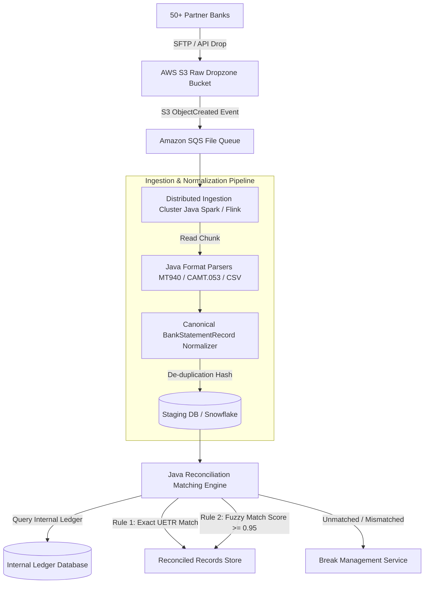
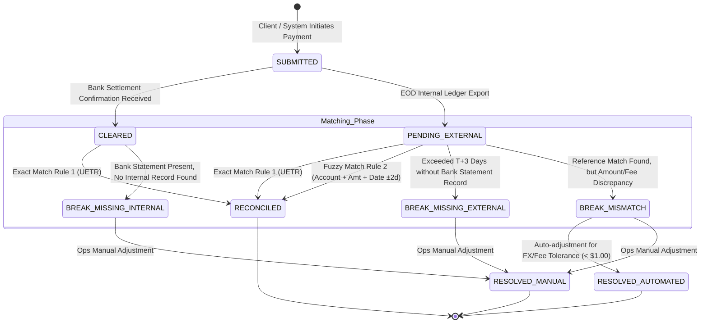

# Spec 2.2: Cross-Border Payment Reconciliation System

## 1. System Objective
Design an enterprise-grade batch and real-time reconciliation engine that ingests external bank clearing statements (e.g. SWIFT MT940, ISO 20022 CAMT.053, ACH/FAST CSV/XML files) from 50+ international partner financial institutions, normalizes disparate statement formats, matches external records against internal ledger entries, and isolates ledger breaks.

## 2. System Requirements

### Functional Requirements
* **Multi-Format Bank File Ingestion**: Parse EOD clearing reports (MT940 flat text, ISO 20022 CAMT XML, custom CSV/Fixed-Width).
* **Multi-Pass Automated Matching Engine**:
  * *Rule 1 (Exact Match)*: 1:1 match on `end_to_end_id` / `uetr` (Unique End-to-End Transaction Reference).
  * *Rule 2 (Fuzzy Match)*: Candidate match on `account_number` + `amount` + `value_date` ($\pm 2\text{ days}$) + `currency`.
* **Break Categorization**: Automatically classify un-reconciled entries into 3 break types:
  1. `MISSING_INTERNAL_RECORD`: External bank cleared a debit/credit, but no internal transaction log exists.
  2. `MISSING_EXTERNAL_RECORD`: Internal transaction logged as submitted, but bank statement has no record after $N$ days.
  3. `VALUE_CURRENCY_MISMATCH`: Identical transaction IDs but discrepancy in amount, currency, or deducted lifting fees.

### Non-Functional Requirements
* **Throughput & Window**: Process **50 million statement lines within a 2-hour window** every morning ($> 7{,}000\text{ records/second}$).
* **Fault-Tolerance & Idempotency**: File ingestion workers must be crash-resilient; resuming failed parse jobs must produce zero duplicate external records.

---

## 3. Scaling & Capacity Estimation

### Data Volume Model
| Metric | Value | Rationale |
| :--- | :--- | :--- |
| Partner banks | 50+ | Multi-corridor cross-border fintech |
| Avg statement lines per bank/day | ~1M | Major corridors (US, EU, ASEAN) generate high volumes |
| Daily ingestion volume | ~50M external records | 50 banks × 1M lines |
| Internal ledger entries to match against | ~5M–10M/day | Internal transaction rate from Spec 2.1 |
| Total matching operations per run | ~50M external × index lookup | Hash-join on UETR, not nested loop |
| Peak processing window | 2 hours (06:00–08:00 UTC) | Before market open / ops team shift start |
| Required sustained throughput | **7,000+ records/second** | 50M / 7,200s |

### Storage Estimation
| Entity | Daily Growth | Monthly | Retention |
| :--- | :--- | :--- | :--- |
| Raw bank statement files (S3) | ~2–5 GB/day (compressed) | ~100 GB/month | 7 years (regulatory) |
| Canonical `BankStatementRecord` rows | 50M rows/day × ~200 bytes | ~300 GB/month raw | 1 year hot, then cold archive |
| `MatchingResult` rows | 50M rows/day × ~150 bytes | ~225 GB/month | 1 year hot |
| **Staging DB hot data (90 days)** | | **~47 TB raw** → ~12 TB with columnar compression | Partitioned by `ingestion_date` |

### Why Spark/Flink and Not a Simple RDBMS?
| Approach | Pros | Cons | Verdict |
| :--- | :--- | :--- | :--- |
| **PostgreSQL batch SQL** | Simple, ACID, familiar | Single-node scan of 50M rows with JOINs against 10M internal records takes 45–90 min. No parallelism without manual sharding. | ❌ Doesn't fit 2-hour SLA at scale |
| **Apache Spark (batch)** | Massively parallel, handles 50M rows in ~15–25 min on 20-node cluster. Excellent for hash-joins. | Higher infra cost, no real-time. | ✅ **Primary batch engine** |
| **Apache Flink (streaming)** | Sub-second latency for real-time recon as statements arrive via SFTP/API. Can process incrementally. | More operational complexity (checkpointing, exactly-once semantics). | ✅ **Future: real-time recon overlay** |
| **Snowflake / BigQuery** | Zero-ops, auto-scaling, SQL-native | Cold start latency, cost at 50M rows/day can exceed $2K/month, query performance less predictable | ⚠️ Acceptable for analytics/reporting layer, not primary engine |

---

## 4. High-Level Ingestion & Normalization Data Flow



### Ingestion Pipeline Design Decisions

| Decision | Choice | Tradeoff |
| :--- | :--- | :--- |
| **De-duplication strategy** | SHA-256 hash of `(bank_id, statement_line_id, amount, value_date, currency)` stored with `INSERT ... ON CONFLICT DO NOTHING` | Adds ~2ms per record for hash computation, but guarantees crash-resume safety. A worker that dies at line 500K of a 1M-line file can restart from line 0 without producing duplicate records. |
| **Chunked parallel parsing** | Split large statement files into 10K-line chunks, distribute across Spark executor partitions | Enables parallel parsing of a single 1M-line file across 100 executors, reducing parse time from 60s (serial) to ~2s (parallel). Tradeoff: chunk boundaries must not split multi-line MT940 transaction blocks (parser must be block-aware). |
| **Canonical model** | All formats normalized to `CanonicalStatementRecord` before matching | Parser complexity is isolated per format adapter. Adding a new bank format requires only a new parser implementation, zero changes to the matching engine. |
| **S3 → SQS event-driven** vs polling | S3 event notifications trigger processing | Eliminates polling waste and ensures files are processed within seconds of arrival. SQS provides at-least-once delivery with visibility timeout for worker crash recovery. |

---

## 5. Canonical Model & Matching Engine Implementation (Java)

```java
package com.financial.reconciliation.engine;

import java.math.BigDecimal;
import java.time.LocalDate;
import java.util.*;

public class Spec2_2 {

    public enum ReconciliationStatus {
        RECONCILED,
        BREAK_MISSING_INTERNAL,
        BREAK_MISSING_EXTERNAL,
        BREAK_MISMATCH
    }

    public record CanonicalStatementRecord(
        String statementLineId,
        String bankId,
        String uetr,
        String accountNumber,
        BigDecimal amount,
        String currency,
        LocalDate valueDate,
        String rawLineHash
    ) {}

    public record InternalLedgerEntry(
        String txnId,
        String uetr,
        String accountNumber,
        BigDecimal amount,
        String currency,
        LocalDate bookingDate
    ) {}

    public record MatchingResult(
        ReconciliationStatus status,
        CanonicalStatementRecord bankRecord,
        InternalLedgerEntry internalRecord,
        String breakReason
    ) {}

    public interface MatchingEngine {
        List<MatchingResult> processMatchingBatch(
            List<CanonicalStatementRecord> bankRecords, 
            List<InternalLedgerEntry> internalEntries
        );
    }
}

public class DefaultMatchingEngine implements Spec2_2.MatchingEngine {

    @Override
    public List<Spec2_2.MatchingResult> processMatchingBatch(
            List<Spec2_2.CanonicalStatementRecord> bankRecords, 
            List<Spec2_2.InternalLedgerEntry> internalEntries) {

        List<Spec2_2.MatchingResult> results = new ArrayList<>();
        Map<String, Spec2_2.InternalLedgerEntry> uetrMap = new HashMap<>();

        for (Spec2_2.InternalLedgerEntry internal : internalEntries) {
            if (internal.uetr() != null && !internal.uetr().isEmpty()) {
                uetrMap.put(internal.uetr(), internal);
            }
        }

        Set<String> matchedInternalIds = new HashSet<>();

        // Rule 1: Exact UETR Match
        for (Spec2_2.CanonicalStatementRecord bankRec : bankRecords) {
            Spec2_2.InternalLedgerEntry internalRec = uetrMap.get(bankRec.uetr());

            if (internalRec != null) {
                matchedInternalIds.add(internalRec.txnId());
                if (bankRec.amount().compareTo(internalRec.amount()) == 0 
                        && bankRec.currency().equalsIgnoreCase(internalRec.currency())) {
                    results.add(new Spec2_2.MatchingResult(
                        Spec2_2.ReconciliationStatus.RECONCILED, bankRec, internalRec, null));
                } else {
                    results.add(new Spec2_2.MatchingResult(
                        Spec2_2.ReconciliationStatus.BREAK_MISMATCH, bankRec, internalRec,
                        "Amount or currency discrepancy: Bank=" + bankRec.amount() + " " + bankRec.currency() 
                        + " vs Internal=" + internalRec.amount() + " " + internalRec.currency()));
                }
            } else {
                // Unmatched bank record
                results.add(new Spec2_2.MatchingResult(
                    Spec2_2.ReconciliationStatus.BREAK_MISSING_INTERNAL, bankRec, null,
                    "No internal transaction found matching UETR " + bankRec.uetr()));
            }
        }

        // Detect Missing External Records
        for (Spec2_2.InternalLedgerEntry internal : internalEntries) {
            if (!matchedInternalIds.contains(internal.txnId())) {
                results.add(new Spec2_2.MatchingResult(
                    Spec2_2.ReconciliationStatus.BREAK_MISSING_EXTERNAL, null, internal,
                    "Internal payment submitted but not present in bank statement"));
            }
        }

        return results;
    }
}
```

### Matching Engine Performance Characteristics

| Phase | Complexity | Time @ 50M records | Notes |
| :--- | :--- | :--- | :--- |
| Build UETR HashMap (internal entries) | O(n) | ~2s for 10M entries | Single-pass, pre-allocated HashMap capacity = `n * 1.5` to avoid rehash |
| Rule 1: Exact UETR lookup | O(1) per record, O(m) total | ~5s for 50M lookups | HashMap.get() is ~50ns per lookup |
| Rule 2: Fuzzy match (unmatched only) | O(k × log n) per fuzzy candidate | ~10–30s (k = unmatched count, typically 1–5% of m) | Composite index on `(account_number, currency, value_date)` in staging DB, queried per unmatched record |
| **Total matching time** | | **~20–40s** on 20-node Spark cluster | Well within 2-hour SLA |

### Why HashMap and Not a Database JOIN?

A SQL `JOIN` between 50M external records and 10M internal records requires the DB to hash or sort-merge both datasets. On PostgreSQL, this takes ~10–20 minutes for a hash join on 60M rows with adequate `work_mem`. The in-memory Java HashMap approach completes in ~7 seconds because:
1. No disk I/O — data is already in executor JVM heap
2. No query planning overhead
3. HashMap lookups are CPU-cache-friendly for sequential iteration

**Tradeoff**: Requires ~3 GB JVM heap for 10M `InternalLedgerEntry` objects (each ~300 bytes). Acceptable on modern Spark executors with 8 GB+ heap per executor.

---

## 6. Transaction Lifecycle State Machine



### State Transition Latency Expectations

| Transition | Typical Latency | Driver |
| :--- | :--- | :--- |
| SUBMITTED → CLEARED | T+0 to T+2 business days | Depends on clearing network (FAST: real-time, SWIFT: T+1, ACH: T+2) |
| SUBMITTED → PENDING_EXTERNAL | EOD batch export (~02:00 UTC) | Batch CDC export from internal ledger |
| PENDING_EXTERNAL → RECONCILED | 06:00–08:00 UTC (morning batch) | Spark recon job processes overnight bank files |
| PENDING_EXTERNAL → BREAK_MISSING_EXTERNAL | T+3 business days | Grace period accounts for settlement delays across time zones |
| BREAK → RESOLVED_MANUAL | 1–48 hours | Ops team SLA for break investigation |
| BREAK_MISMATCH → RESOLVED_AUTOMATED | < 5 minutes | Auto-tolerance for amounts within $1.00 / 0.1% (whichever is lower) — covers FX rounding and lifting fees |

---

## 7. Failure Points & Recovery

| Failure Scenario | Impact | Detection | Recovery Strategy | RTO |
| :--- | :--- | :--- | :--- | :--- |
| **SFTP/API bank file delivery delayed** | Recon job runs with incomplete data; legitimate entries flagged as BREAK_MISSING_EXTERNAL | Monitor expected file count per bank vs received count by 06:00 UTC cutoff | Defer recon for that bank's corridor until file arrives. Publish `FILE_DELAYED` alert to ops dashboard. Re-run partial recon on arrival. | < 4h (SLA with bank) |
| **Spark executor OOM during matching** | Batch job fails mid-partition | Spark driver detects lost executor, Spark UI shows OOM in executor logs | Increase `spark.executor.memory` from 8g → 16g. For structural fix: repartition by `bank_id` to reduce skew (one large bank's 10M records may all land on one partition). | < 30min (re-run) |
| **Duplicate bank file re-delivery** | Same records ingested twice → inflated break counts | SHA-256 de-duplication hash on `(bank_id, line_id, amount, value_date)` with `ON CONFLICT DO NOTHING` | Silently deduplicated at ingestion layer. Metric `recon.ingestion.dedup_hit_rate` spikes above 5% triggers investigation into bank SFTP behavior. | None (auto-handled) |
| **Staging DB disk full** | Ingestion writes fail, batch stalls | Disk usage monitoring with alert at 80% threshold | Partition pruning: drop partitions older than 90 days. Emergency: expand EBS volume (online resize in AWS). | < 15min |
| **Internal ledger DB unavailable during recon** | Cannot join external records against internal entries | Connection timeout after 5s, retry 3× with exponential backoff | Recon job defers to next scheduled window. If repeated, failover to read replica for matching (acceptable since recon is read-only on internal data). | < 2h (next window) |
| **Matching rule produces false positive** | Fuzzy match pairs wrong transactions → ops confusion | Break review dashboard shows high `RESOLVED_MANUAL` rate for fuzzy-matched records | Tighten fuzzy threshold from 0.95 → 0.98 confidence. Add mandatory human review for fuzzy matches > $10,000. | Config change |
| **Recon data corrupted after errant code deploy** | Break counts spike 100×, ops overwhelmed | Anomaly detection on `recon.break_count` (> 3σ from 30-day rolling average) | Automatic rollback via feature flag. Re-run recon from raw S3 files (immutable source of truth) with previous engine version. | < 1h |

### Data Integrity Invariants (Enforced Post-Recon)

```
Assertion 1: COUNT(external_records) = COUNT(reconciled) + COUNT(breaks)
Assertion 2: No external record maps to more than one internal record (1:1 or 1:0)
Assertion 3: SUM(reconciled_amounts) by currency matches SUM(internal_settled_amounts) within FX tolerance
```

These assertions run as the final step of every recon batch. Violation triggers a `RECON_INTEGRITY_VIOLATION` P1 alert.

---

## 8. Metrics, Tracing & Observability

### Key Operational Metrics

| Metric | Type | Alert Threshold | Why It Matters |
| :--- | :--- | :--- | :--- |
| `recon.batch.duration_minutes` | Gauge | > 90min → P3; > 120min → P2 (SLA breach) | 2-hour window compliance |
| `recon.batch.records_processed` | Counter | < 40M (80% of expected) → P3 | File delivery or ingestion failure indicator |
| `recon.match_rate` | Gauge (%) | < 95% → P3; < 90% → P2 | Industry benchmark: ~97–99% auto-reconciliation. Drop signals systematic issue. |
| `recon.break.count_by_type` | Counter (tagged by type) | MISSING_INTERNAL spike > 3σ → P2 | Often indicates internal ledger write failure or delayed CDC |
| `recon.break.age_hours` | Histogram | Any break > 72h unresolved → P3 escalation | Ops SLA compliance |
| `recon.ingestion.dedup_hit_rate` | Gauge (%) | > 5% → P4 investigate | Bank re-delivering files or SFTP sync issue |
| `recon.fuzzy_match.false_positive_rate` | Gauge (%) | > 2% → tighten threshold | Measured by ops override rate on fuzzy matches |
| `recon.file.expected_vs_received` | Gauge | Gap > 2 banks → P3 | Early warning for missing bank files before recon starts |

### Batch Job Tracing (Spark/Flink)

Each recon batch run is assigned a `batchRunId` that tags:
- **Ingestion phase**: File parse duration, records per bank, dedup counts
- **Matching phase**: Rule 1 match count, Rule 2 fuzzy match count, break counts by type
- **Post-recon assertions**: Pass/fail status for each integrity check

```
[batchRunId: recon-2025-09-08-0600]
  ├─ ingestion.total_files: 53
  ├─ ingestion.total_records: 51,234,891
  ├─ ingestion.parse_errors: 12 (tagged by bank_id)
  ├─ matching.rule1_exact_matches: 49,102,333 (95.8%)
  ├─ matching.rule2_fuzzy_matches: 1,456,221 (2.8%)
  ├─ matching.breaks.missing_internal: 234,112
  ├─ matching.breaks.missing_external: 389,002
  ├─ matching.breaks.value_mismatch: 53,223
  ├─ assertions.record_count_check: PASS
  ├─ assertions.1_to_1_mapping_check: PASS
  ├─ assertions.amount_balance_check: PASS
  └─ total_duration_minutes: 47
```

### Ops Break Dashboard (Real-time)

The break management dashboard provides:
- **Break aging heatmap**: Color-coded by age (green: <24h, yellow: 24–48h, red: >48h) per bank corridor
- **Auto-resolution rate**: Percentage of `BREAK_MISMATCH` records auto-resolved by FX tolerance rules
- **Drill-down**: Click any break to see side-by-side view of bank statement line vs internal ledger entry

---

## 9. Self-Evaluation Checklist
- [x] **Ingestion Architecture**: S3 dropzone $\rightarrow$ Distributed Java Spark/Flink streaming parsers handling 50M records in 2h.
- [x] **Java Matching Engine**: Canonical Java data model and multi-rule matching engine implementation with O(n) HashMap performance analysis.
- [x] **Break Categorization**: Classified into Missing Internal, Missing External, and Value/Currency Mismatch.
- [x] **State Machine Diagram**: Complete state transitions from `SUBMITTED` to `RECONCILED` or `BREAK_DISCREPANCY` and resolution states with latency expectations.
- [x] **Scaling & Capacity**: Real volume numbers (50M records/day, 50+ banks), storage estimates, and Spark vs RDBMS tradeoff comparison.
- [x] **Failure Points & Recovery**: 7 failure modes including data skew, disk exhaustion, and false positives, with RTO and recovery strategies.
- [x] **Metrics & Tracing**: Batch job trace schema, operational metrics with alert thresholds, and break dashboard design.
