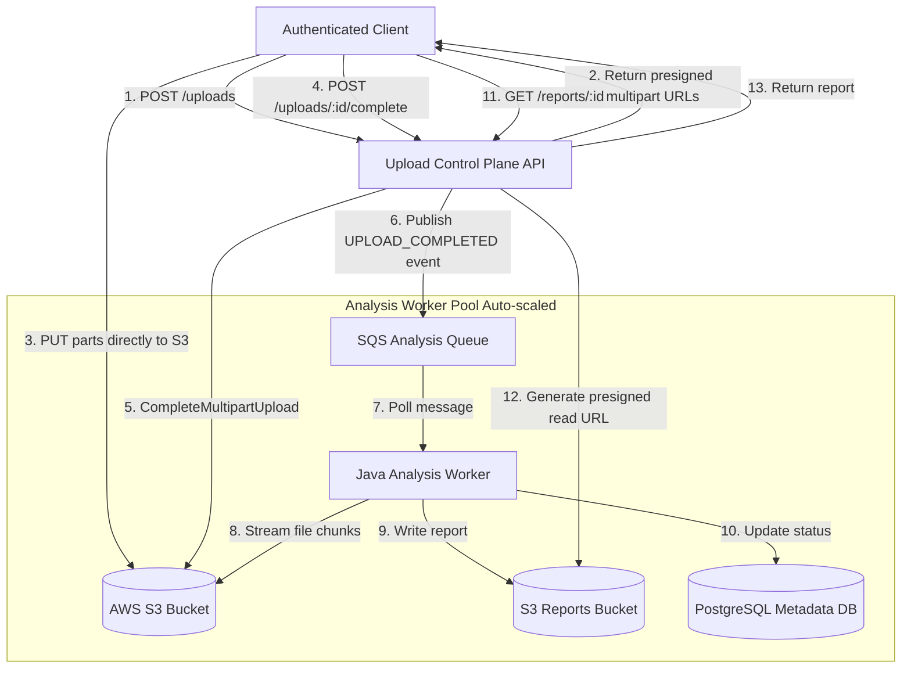
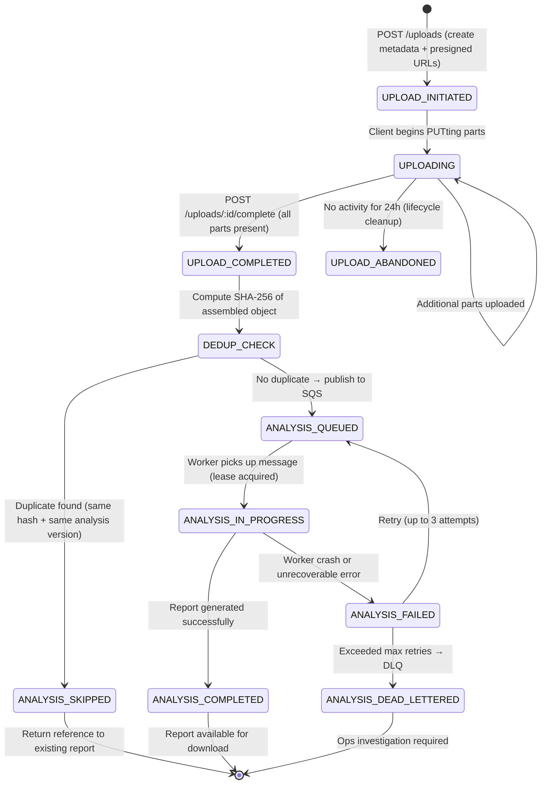
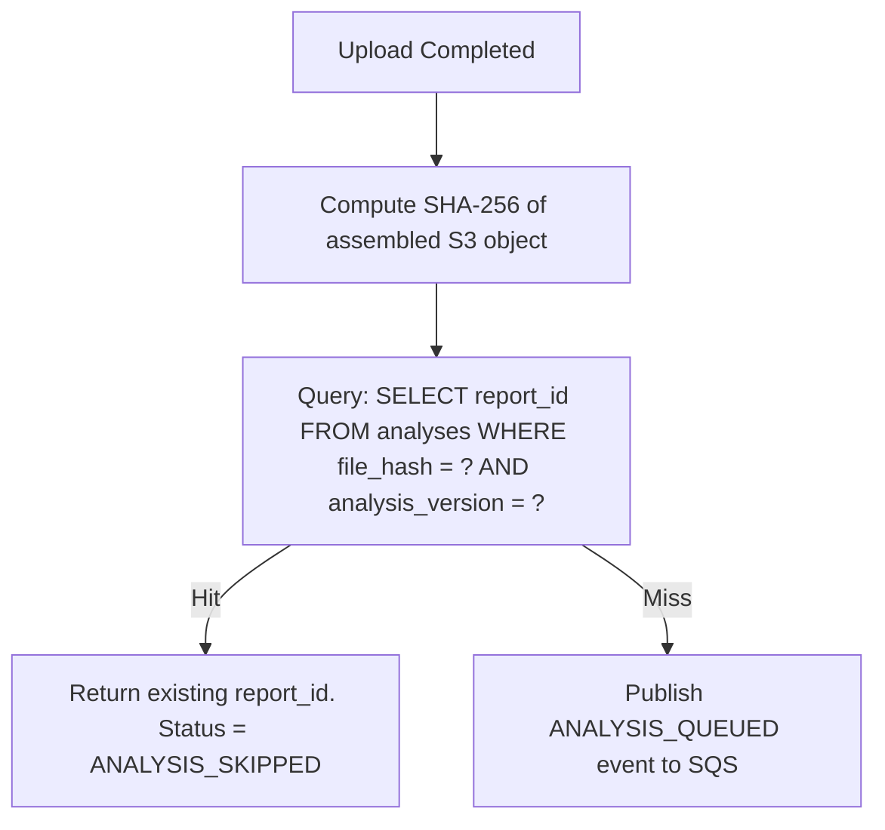

# Spec 2.6: Async File Upload & Analysis Pipeline

## 1. System Objective
Design a service where authenticated users upload potentially large files (up to 200 GB), processing runs asynchronously via scalable worker pools, and users later view generated reports. The system must guarantee exactly-once analysis per file+version combination, support resumable uploads, enforce strict tenant isolation, and recover gracefully from worker crashes mid-analysis.

## 2. System Requirements

### Functional Requirements
* **Resumable Multipart Upload**: Upload files up to 200 GB via presigned multipart URLs directly to object storage, resumable after client disconnection.
* **Async Analysis Pipeline**: After upload completes, trigger analysis workers that process files in streaming/chunked fashion (no full-file memory load).
* **Report Generation & Retrieval**: Users query report status and download completed reports via presigned read URLs.
* **Duplicate Prevention**: The same file content (by SHA-256 hash) must not be re-analyzed for the same analysis version. Return the existing report.
* **Analysis Versioning**: Support multiple analysis versions. Upgrading the analysis version produces a new report without overwriting the previous one.

### Non-Functional Requirements
* **Upload Throughput**: Support 1,000 concurrent uploads at steady state.
* **Analysis Latency**: P95 analysis completion < 10 minutes for files ≤ 1 GB. Larger files scale linearly.
* **Availability**: 99.9% for upload API; 99.95% for report retrieval.
* **Tenant Isolation**: A user must never read, list, or infer the existence of another user's files or reports.

---

## 3. Scaling & Capacity Estimation

### Traffic Model
| Metric | Value | Rationale |
| :--- | :--- | :--- |
| Registered users | 500K | Enterprise SaaS (compliance, data analytics platform) |
| DAU | 50K (10%) | Active uploaders + report consumers |
| Uploads per day | ~20K files | Mix of small (< 100 MB) and large (1–200 GB) |
| Avg file size | ~500 MB | Bimodal: many small CSVs + some large genomic/video files |
| Daily ingress | 20K × 500 MB = **~10 TB/day** | S3 PUT throughput: 3,500 PUT/sec per prefix — no bottleneck |
| Peak concurrent uploads | 1,000 | Morning burst (batch uploads from automated pipelines) |
| Active analysis jobs | ~500 concurrent | Workers process files faster than they arrive at steady state |
| Reports generated per day | ~20K | 1:1 with uploads (minus dedup hits) |
| Report storage | ~10 KB–10 MB per report (JSON/PDF) | Much smaller than source files |

### Storage Estimation
| Entity | Daily Growth | Monthly | Retention |
| :--- | :--- | :--- | :--- |
| Source files (S3) | 10 TB/day | 300 TB/month | 90 days hot (S3 Standard), then S3 Glacier (7-year regulatory) |
| Reports (S3) | ~50 GB/day | 1.5 TB/month | Indefinite (small, cheap) |
| Metadata DB (PostgreSQL) | ~20K rows/day × 500 bytes | ~300 MB/month | Indefinite |
| Upload multipart parts (S3) | Transient | Auto-cleaned by lifecycle rule after 7 days | S3 AbortIncompleteMultipartUpload lifecycle |

### Cost Estimate (AWS)
| Component | Monthly Cost (approx) | Notes |
| :--- | :--- | :--- |
| S3 Standard (300 TB hot) | ~$7,000 | $0.023/GB/month |
| S3 Glacier (archive) | ~$1,200 per 300 TB | $0.004/GB/month |
| S3 PUT/GET requests | ~$500 | 20K uploads × multipart parts |
| EC2 worker fleet (20 × c5.2xlarge) | ~$5,000 | Auto-scaled; spot instances for cost optimization |
| PostgreSQL RDS (db.r6g.large) | ~$300 | Metadata store |
| **Total** | **~$14,000/month** | Scales linearly with volume |

---

## 4. High-Level Architecture



### Why Direct-to-S3 Upload (Not Proxied Through App Server)?

| Approach | Pros | Cons | Verdict |
| :--- | :--- | :--- | :--- |
| **Direct S3 presigned upload** | Zero app-server bandwidth; client uploads at full network speed; no OOM risk; supports 5 TB files natively | More complex client SDK; presigned URL expiry management | ✅ **Chosen** |
| **Proxy through API server** | Simpler client; server can validate on-the-fly | Server becomes bottleneck (1 Gbps NIC limits ~125 MB/s); OOM for large files; scales poorly | ❌ Rejected for files > 100 MB |
| **tus.io resumable protocol** | Standard resumable protocol; good client ecosystem | Requires dedicated tus server; still proxies bytes through a server | ⚠️ Alternative for < 5 GB files |

### Why Presigned URLs and Not IAM Credentials?

Giving clients temporary IAM credentials (via STS) allows them to upload but also exposes S3 API surface (ListBucket, DeleteObject). Presigned URLs are scoped to a single operation (PutObject on a specific key) with a short TTL (15 min). Minimal privilege, maximum isolation.

---

## 5. Upload & Analysis State Machine



### State Transition Latency

| Transition | Typical Latency | Driver |
| :--- | :--- | :--- |
| INITIATED → UPLOADING | < 1s | Client starts uploading immediately after receiving presigned URLs |
| UPLOADING → COMPLETED | Seconds to hours | Depends on file size and network speed (1 GB @ 100 Mbps ≈ 80s) |
| COMPLETED → DEDUP_CHECK | < 5s | S3 ETag (MD5 of parts) available immediately; SHA-256 requires async read |
| DEDUP_CHECK → QUEUED | < 1s | SQS publish |
| QUEUED → IN_PROGRESS | < 30s | SQS visibility timeout + worker poll interval |
| IN_PROGRESS → COMPLETED | < 10 min (P95 for ≤ 1 GB) | Analysis computation time |

---

## 6. Upload API & Presigned URL Flow (Java)

```java
package com.platform.upload.controller;

import java.time.Duration;
import java.util.*;
import org.springframework.web.bind.annotation.*;
import software.amazon.awssdk.services.s3.S3Client;
import software.amazon.awssdk.services.s3.model.*;
import software.amazon.awssdk.services.s3.presigner.S3Presigner;
import software.amazon.awssdk.services.s3.presigner.model.UploadPartPresignRequest;

public record InitiateUploadRequest(
    String fileName,
    long fileSizeBytes,
    String contentType
) {}

public record InitiateUploadResponse(
    String uploadId,
    String s3UploadId,
    List<PresignedPartUrl> presignedUrls
) {}

public record PresignedPartUrl(int partNumber, String url) {}

@RestController
@RequestMapping("/v1/uploads")
public class UploadController {

    private final S3Client s3Client;
    private final S3Presigner s3Presigner;
    private final UploadMetadataRepository metadataRepo;
    private static final String BUCKET = "user-uploads";
    private static final long PART_SIZE = 100 * 1024 * 1024; // 100 MB parts

    public UploadController(S3Client s3Client, S3Presigner s3Presigner,
                            UploadMetadataRepository metadataRepo) {
        this.s3Client = s3Client;
        this.s3Presigner = s3Presigner;
        this.metadataRepo = metadataRepo;
    }

    @PostMapping
    public InitiateUploadResponse initiateUpload(
            @RequestAttribute("userId") String userId,
            @RequestBody InitiateUploadRequest req) {

        String uploadId = "UPL_" + UUID.randomUUID();
        String s3Key = String.format("uploads/%s/%s/%s", userId, uploadId, req.fileName());

        // 1. Initiate S3 multipart upload
        CreateMultipartUploadResponse s3Response = s3Client.createMultipartUpload(
            CreateMultipartUploadRequest.builder()
                .bucket(BUCKET).key(s3Key).contentType(req.contentType())
                .serverSideEncryption(ServerSideEncryption.AES256)
                .build());

        // 2. Generate presigned URLs for each part
        int totalParts = (int) Math.ceil((double) req.fileSizeBytes() / PART_SIZE);
        List<PresignedPartUrl> presignedUrls = new ArrayList<>();

        for (int part = 1; part <= totalParts; part++) {
            String url = s3Presigner.presignUploadPart(
                UploadPartPresignRequest.builder()
                    .signatureDuration(Duration.ofMinutes(60))
                    .uploadPartRequest(UploadPartRequest.builder()
                        .bucket(BUCKET).key(s3Key)
                        .uploadId(s3Response.uploadId())
                        .partNumber(part).build())
                    .build()).url().toString();
            presignedUrls.add(new PresignedPartUrl(part, url));
        }

        // 3. Persist metadata
        metadataRepo.save(uploadId, userId, s3Key, s3Response.uploadId(),
            req.fileSizeBytes(), "UPLOAD_INITIATED");

        return new InitiateUploadResponse(uploadId, s3Response.uploadId(), presignedUrls);
    }

    @PostMapping("/{uploadId}/complete")
    public Map<String, String> completeUpload(
            @RequestAttribute("userId") String userId,
            @PathVariable String uploadId,
            @RequestBody List<CompletedPart> completedParts) {

        var metadata = metadataRepo.findByIdAndUserId(uploadId, userId)
            .orElseThrow(() -> new IllegalArgumentException("Upload not found"));

        // Complete S3 multipart upload
        s3Client.completeMultipartUpload(CompleteMultipartUploadRequest.builder()
            .bucket(BUCKET).key(metadata.s3Key()).uploadId(metadata.s3UploadId())
            .multipartUpload(CompletedMultipartUpload.builder().parts(completedParts).build())
            .build());

        metadataRepo.updateStatus(uploadId, "UPLOAD_COMPLETED");

        // Publish analysis event (via transactional outbox or direct SQS)
        publishAnalysisEvent(uploadId, metadata.s3Key(), userId);

        return Map.of("status", "UPLOAD_COMPLETED", "uploadId", uploadId);
    }
}
```

### Resuming a 200 GB Upload After Client Disconnection

S3 multipart upload is inherently resumable:
1. Each 100 MB part is an independent PUT request with its own presigned URL
2. Client tracks which parts succeeded (S3 returns ETag per part)
3. On reconnection, client calls `GET /uploads/{id}/status` which returns the list of confirmed parts
4. Client re-uploads only missing parts using fresh presigned URLs (re-generated for remaining parts)
5. No server-side state management needed — S3 tracks uploaded parts natively via `ListParts`

**Why 100 MB part size?**
| Part Size | # Parts for 200 GB | Tradeoff |
| :--- | :--- | :--- |
| 10 MB | 20,000 | Too many presigned URLs to generate; hits S3 10,000-part limit |
| 100 MB | 2,000 | Good balance: each part uploads in ~8s on a 100 Mbps connection. Failure wastes at most 8s of work. |
| 1 GB | 200 | Fewer parts, but each takes 80s. A failure wastes 80s. Not ideal for mobile/unreliable connections. |

---

## 7. Duplicate Analysis Prevention

### Deduplication Strategy



### How SHA-256 Is Computed Without Loading the Entire File

```java
// Stream S3 object in 8 MB chunks, update MessageDigest incrementally
public String computeS3ObjectHash(String bucket, String key) {
    MessageDigest digest = MessageDigest.getInstance("SHA-256");
    try (var s3Stream = s3Client.getObject(GetObjectRequest.builder()
            .bucket(bucket).key(key).build())) {
        byte[] buffer = new byte[8 * 1024 * 1024]; // 8 MB buffer
        int bytesRead;
        while ((bytesRead = s3Stream.read(buffer)) != -1) {
            digest.update(buffer, 0, bytesRead);
        }
    }
    return Hex.encodeHexString(digest.digest());
}
// For 200 GB file: ~25,000 iterations × ~100ms/read ≈ ~40 minutes
// Optimization: compute hash client-side during upload, verify server-side
```

**Why not use S3 ETag as the hash?** S3 ETag for multipart uploads is `MD5-of-part-MD5s`, not a hash of the file content. It depends on part size and count, so the same file uploaded with different part sizes produces different ETags. SHA-256 of the full content is deterministic.

### Preventing Double-Job from Event + Completion Call Race

**Problem**: S3 `ObjectCreated` event and client's `POST /complete` call arrive simultaneously → two analysis jobs for the same file.

**Solution**: The system does NOT use S3 events as the trigger. Only the `POST /complete` endpoint publishes the analysis event, inside a `@Transactional` block that atomically sets `status = UPLOAD_COMPLETED` with a `WHERE status = UPLOADING` guard. A second call sees `status != UPLOADING` and is a no-op.

```sql
UPDATE uploads SET status = 'UPLOAD_COMPLETED'
WHERE id = ? AND user_id = ? AND status = 'UPLOADING'
RETURNING id;
-- Returns 0 rows on duplicate call → no event published
```

---

## 8. Worker Architecture & Scaling

### Worker Design

```java
@Component
public class AnalysisWorker {

    @SqsListener(queueNames = "analysis-queue", maxConcurrentMessages = "5")
    public void processAnalysis(AnalysisEvent event) {
        // 1. Acquire lease (set status = IN_PROGRESS with worker_id and lease_expiry)
        boolean leaseAcquired = metadataRepo.tryAcquireLease(
            event.uploadId(), workerId, Duration.ofMinutes(30));
        if (!leaseAcquired) return; // Another worker already processing

        try {
            // 2. Stream file from S3 in chunks (no full-file memory load)
            try (var s3Stream = s3Client.getObject(...)) {
                Report report = analyzeStream(s3Stream); // Streaming analysis
            }

            // 3. Write report to S3
            s3Client.putObject(reportKey, report.toBytes());

            // 4. Update metadata
            metadataRepo.updateStatus(event.uploadId(), "ANALYSIS_COMPLETED", report.s3Key());
        } catch (RetryableException e) {
            // Re-throw → SQS message becomes visible again after visibility timeout
            throw e;
        } catch (Exception e) {
            metadataRepo.updateStatus(event.uploadId(), "ANALYSIS_FAILED", e.getMessage());
            // After 3 retries, SQS routes to DLQ
        }
    }
}
```

### Worker Scaling Strategy

| Parameter | Value | Rationale |
| :--- | :--- | :--- |
| Base worker count | 5 instances (c5.2xlarge: 8 vCPU, 16 GB) | Handles steady-state ~2K analyses/day |
| Max worker count | 50 instances | Peak burst capacity |
| Scale trigger | SQS `ApproximateNumberOfMessages` > 100 for 2 min | Queue depth reflects backlog |
| Scale-down trigger | Queue empty for 10 min | Avoid premature scale-down (analyses take minutes) |
| Concurrency per worker | 5 concurrent analyses | CPU-bound analysis on 8 cores = ~5 parallel jobs |
| Spot instances | 80% spot + 20% on-demand | 60–70% cost savings; SQS retry handles spot termination |
| Visibility timeout | 30 minutes | Must exceed max analysis duration to prevent duplicate processing |

### Lease Mechanism (Preventing Duplicate Processing)

```sql
UPDATE analyses
SET status = 'IN_PROGRESS',
    worker_id = ?,
    lease_expires_at = NOW() + INTERVAL '30 minutes'
WHERE upload_id = ? AND status = 'ANALYSIS_QUEUED'
RETURNING upload_id;
```

If a worker crashes mid-analysis:
1. SQS message becomes visible after 30-minute visibility timeout
2. New worker picks it up, attempts lease acquisition
3. `WHERE status = 'ANALYSIS_QUEUED'` fails because status is `IN_PROGRESS`
4. **Stale lease sweeper** (runs every 5 min): resets `IN_PROGRESS` jobs with `lease_expires_at < NOW()` back to `ANALYSIS_QUEUED`
5. SQS re-delivers; new worker acquires fresh lease

---

## 9. Tenant Authorization & Security

### Authorization Model

```mermaid
flowchart LR
    Client -->|JWT Bearer Token| Gateway[API Gateway]
    Gateway -->|Extract user_id from JWT claims| API[Upload Service]
    API -->|S3 key prefix: uploads/{user_id}/| S3[(S3)]
    API -->|WHERE user_id = ? on every query| DB[(PostgreSQL)]
```

| Security Control | Implementation | Why |
| :--- | :--- | :--- |
| **S3 key prefix isolation** | `uploads/{userId}/{uploadId}/filename` | Presigned URLs scoped to user's prefix. Even if URL leaks, it only accesses that user's path. |
| **DB-level row filtering** | Every SQL query includes `WHERE user_id = ?` (no admin bypass in application) | Defense-in-depth against IDOR (Insecure Direct Object Reference) |
| **Presigned URL scoping** | Each URL is a signed `PutObject` on a specific key; no wildcard access | User cannot list or delete other objects |
| **Encryption at rest** | S3 SSE-S3 (AES-256) default; SSE-KMS for regulated data | Compliance (SOC 2, HIPAA) |
| **Encryption in transit** | TLS 1.3 enforced on all endpoints + S3 bucket policy denying HTTP | Prevents MITM |
| **Malware scanning** | S3 ObjectCreated → Lambda → ClamAV scan before analysis queue | Prevent processing malicious files; quarantine to isolated bucket if infected |
| **Report access** | Presigned GET URLs with 15-min TTL, scoped to `reports/{userId}/` | Time-limited, user-scoped read access |

---

## 10. Failure Points & Recovery

| Failure | Impact | Detection | Recovery | RTO |
| :--- | :--- | :--- | :--- | :--- |
| **Client disconnects mid-upload** | Partial multipart upload in S3 | Client tracks uploaded parts | Client resumes: `GET /uploads/{id}/status` returns confirmed parts → re-upload missing parts only | Instant resume |
| **S3 multipart upload abandoned** | Orphaned parts consuming storage | S3 lifecycle rule: `AbortIncompleteMultipartUpload` after 7 days | Automatic cleanup; no manual intervention | Automatic |
| **Worker crash mid-analysis** | SQS message re-delivered; partial report may exist in S3 | Stale lease sweeper resets job; SQS visibility timeout re-surfaces message | New worker starts fresh (idempotent: overwrites partial report). Lease mechanism prevents two workers processing simultaneously. | < 35min (visibility timeout + sweep) |
| **Worker OOM on large file** | Analysis fails | JVM OOM error logged; container restarts | Workers MUST use streaming processing (8 MB buffer), never load full file. If analysis inherently requires random access: use memory-mapped file from EBS-backed temp disk, not heap. | < 5min (restart + re-queue) |
| **SQS message lost** (extremely rare) | Analysis never triggered | Sweeper job: `SELECT * FROM uploads WHERE status = 'UPLOAD_COMPLETED' AND created_at < NOW() - INTERVAL '1 hour'` → re-publish to SQS | Sweeper is the defense-in-depth safety net. Runs every 10 min. | < 70min |
| **SHA-256 hash collision** | Two different files treated as identical → wrong report returned | Probability: $< 10^{-38}$ for SHA-256 | Effectively impossible. For paranoid mode: store file size alongside hash; compare both. | N/A |
| **Analysis version upgrade** | Old reports must remain accessible; new version must not overwrite | Version is part of the dedup key: `(file_hash, analysis_version)` | New version produces new report with `version=v2` tag. Old reports remain at `version=v1`. User can query by version. | By design |
| **Presigned URL expires before upload completes** | Part upload fails with `403 Forbidden` | Client detects 403 on PUT | Client calls `POST /uploads/{id}/refresh-urls` to get fresh presigned URLs for remaining parts. Original `s3UploadId` is reused. | Instant |
| **Malware detected in uploaded file** | File quarantined; analysis blocked | ClamAV Lambda returns `INFECTED` status | Update metadata to `QUARANTINED`. Notify user. Do not process. Ops can review quarantine bucket. | < 5min |

---

## 11. Metrics, Tracing & Observability

### Key Metrics

| Metric | Type | Alert Threshold |
| :--- | :--- | :--- |
| `upload.initiated.count` | Counter | Informational — demand signal |
| `upload.completed.count` | Counter | < 70% of initiated (30%+ abandon rate) → UX investigation |
| `upload.size_bytes` | Histogram | Informational — capacity planning |
| `upload.duration_seconds` | Histogram | P95 > 10min for files < 1 GB → network issue |
| `analysis.queue.depth` | Gauge (SQS) | > 500 for 5min → scale up workers |
| `analysis.queue.age_seconds` | Gauge (oldest msg) | > 600s (10min) → queue draining too slowly |
| `analysis.duration_seconds` | Histogram (by file size bucket) | P95 > 30min for ≤ 1 GB → worker perf regression |
| `analysis.dedup.hit_rate` | Gauge (%) | Informational — ROI of dedup logic |
| `analysis.failure_rate` | Gauge (%) | > 5% → P2 alert |
| `analysis.dlq.count` | Counter | > 0 → P3 ops investigation |
| `worker.lease.stale_count` | Counter | > 0 → workers crashing; investigate OOM/spot termination |
| `malware.scan.infected_count` | Counter | > 0 → P2 security alert |
| `s3.orphaned_multipart.count` | Gauge | > 1,000 → lifecycle rule not firing |

### Distributed Tracing

```
[traceId: upl-abc123]
  [span: upload.initiate]                    ← 50ms (creates metadata + presigned URLs)
  [span: upload.part_put × N]               ← client-side (not server-traced)
  [span: upload.complete]                    ← 200ms (S3 CompleteMultipart + SQS publish)
    [span: s3.complete_multipart]            ← 150ms
    [span: sqs.publish_analysis_event]       ← 30ms
  [span: analysis.dedup_check]              ← 40s–40min (SHA-256 streaming)
    [span: s3.get_object_stream]
    [span: hash.sha256_compute]
    [span: db.dedup_lookup]                  ← 2ms
  [span: analysis.process]                  ← 1–30min
    [span: s3.stream_read]                   ← (tag: bytes_processed)
    [span: analysis.compute]                 ← (tag: analysis_version)
    [span: s3.write_report]                  ← 100ms
    [span: db.update_status]                 ← 5ms
```

---

## 12. Self-Evaluation Checklist
- [x] **Upload Architecture**: Direct S3 multipart with presigned URLs, resumable after disconnection.
- [x] **State Machine**: 10-state lifecycle covering upload, dedup, analysis, failure, and dead-letter.
- [x] **Duplicate Prevention**: SHA-256 content hash + analysis version as dedup key, with double-job race prevention.
- [x] **Worker Scaling**: SQS-driven auto-scaling (5–50 instances), lease mechanism, spot instance support.
- [x] **Streaming Processing**: 8 MB chunked reads, no full-file memory load, memory-mapped fallback for random access.
- [x] **Tenant Isolation**: S3 prefix + DB row filter + scoped presigned URLs + encryption.
- [x] **Failure Points & Recovery**: 9 failure modes with detection, recovery, and RTO.
- [x] **Metrics & Tracing**: Upload funnel, queue health, worker performance, and security metrics.
