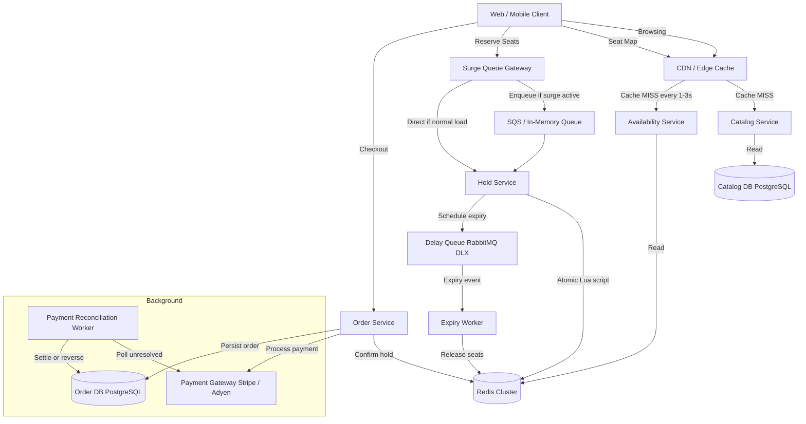
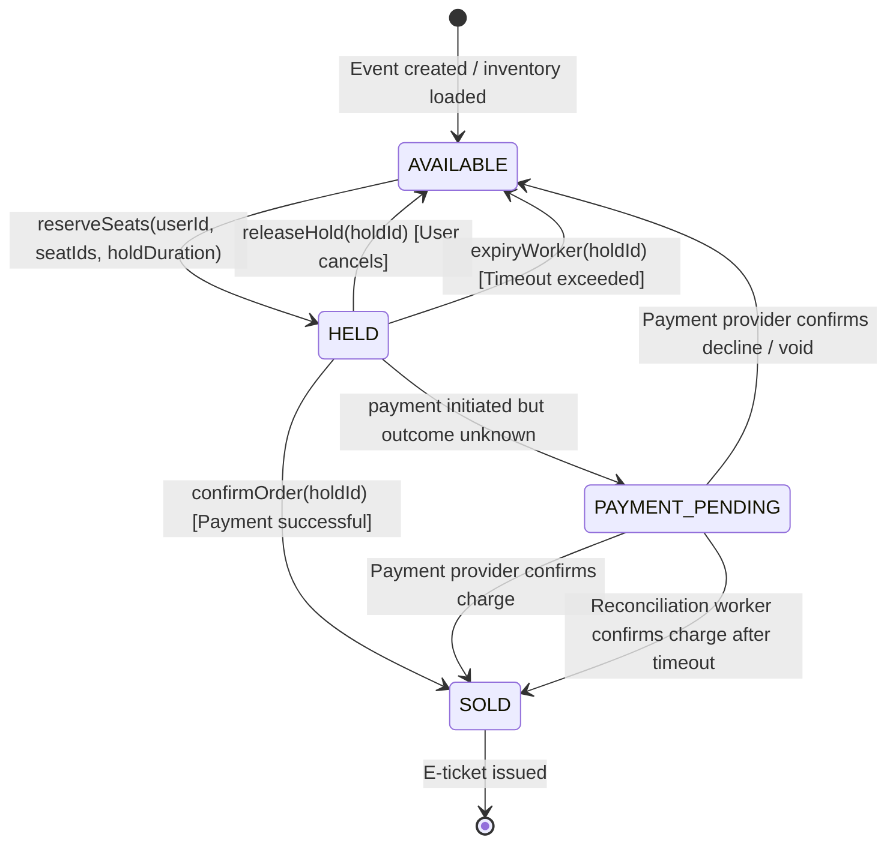
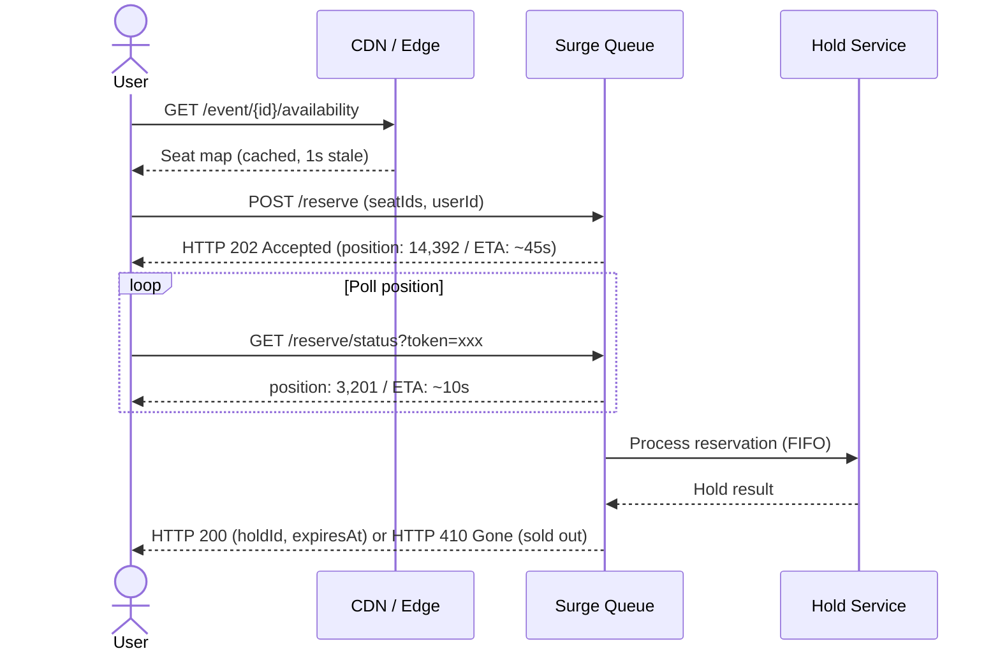
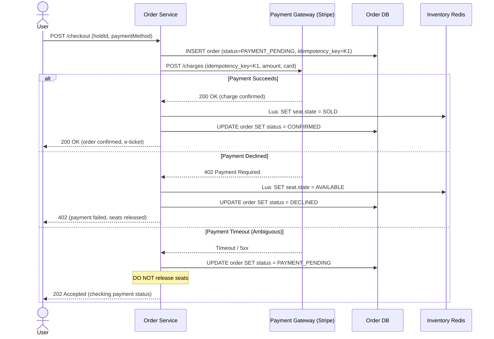

# Spec 2.7: High-Demand Ticketing System

## 1. System Objective
Design a ticketing platform for high-demand events (concerts, sports) where users discover events, view seat/section availability, temporarily hold inventory, complete payment, and receive confirmed orders — without ever selling the same seat twice. The system must handle the surge when sales open (100K+ users hitting inventory simultaneously), provide fair access, and gracefully handle payment provider timeouts that produce ambiguous charge outcomes.

## 2. System Requirements

### Functional Requirements
* **Event Discovery & Search**: Browse and search events by date, genre, venue, artist. Eventually consistent reads acceptable.
* **Seat Map / Availability View**: Real-time (or near-real-time) seat-level or section-level availability rendering.
* **Temporary Hold (Reserve)**: User selects seat(s) → system creates a time-bound hold (e.g. 10 minutes) → seat(s) become unavailable to other users.
* **Checkout & Payment**: User completes payment within hold window → order confirmed → e-ticket issued.
* **Hold Expiry**: Unconfirmed holds automatically release seats back to available inventory.
* **Best-Available Allocation**: For general-admission or group purchases, system selects the best N adjacent available seats.

### Non-Functional Requirements
* **Throughput**: Handle **100,000+ concurrent users** attempting seat holds when a major event goes on-sale.
* **Zero Oversell**: A confirmed seat must never be assigned to two different orders. This is the #1 invariant.
* **Hold Expiry Accuracy**: Within $\pm 2\text{ seconds}$ of configured timeout.
* **Eventual Consistency for Reads**: Seat map can be ~1–3 seconds stale. Checkout inventory must be strongly consistent.
* **Payment Resilience**: Gracefully handle payment provider timeouts where charge outcome is unknown.

---

## 3. Scaling & Capacity Estimation

### Traffic Model: Major Event On-Sale
| Metric | Value | Rationale |
| :--- | :--- | :--- |
| Event capacity | 80,000 seats (large stadium) | Taylor Swift / FIFA scale |
| Concurrent users at on-sale | 100,000–500,000 | 5–10× seat count for popular events |
| Peak seat-hold TPS | 50,000 | First 30 seconds: everyone clicks simultaneously |
| Steady-state TPS (after initial rush) | 2,000–5,000 | Slower browsers, retry on sold-out sections |
| Avg checkout completion rate | 70% of holds → confirmed | 30% abandon/expire |
| Payment API calls/sec (peak) | ~5,000 | Only users who reach checkout step |
| Seat map refresh requests/sec | 200,000+ (CDN-cached) | Every user polls availability |

### Inventory Data Size
| Entity | Scale | Storage |
| :--- | :--- | :--- |
| Events | 10K active events | ~10 MB metadata |
| Seats per event | 80K (large venue) | ~15 MB per event (seat ID, section, row, status, price) |
| Active holds | Up to 80K concurrent | ~16 MB in Redis (200 bytes per hold) |
| Orders | ~50K per major event | ~25 MB |
| Total hot data | | < 100 MB per event — fits entirely in Redis |

### Why the On-Sale Surge Is the Hard Problem

Steady-state ticketing is trivial (100 TPS). The entire design exists for the **30-second thundering herd** when sales open:
- 500K users load the seat map simultaneously → CDN must absorb 200K+ req/sec
- 50K users click "Reserve" within 5 seconds → inventory system must serialize 10K seat-lock operations/second
- If the system takes 200ms per hold, only 5,000/sec get through → 90% get "sold out" errors → immediate retry storm

---

## 4. Service Architecture



### Service Boundaries & Responsibilities

| Service | Responsibility | Data Store | Consistency |
| :--- | :--- | :--- | :--- |
| **Catalog Service** | Event metadata, venue, pricing, search | PostgreSQL + Elasticsearch | Eventually consistent (indexed with ~2s lag) |
| **Availability Service** | Seat status reads for UI rendering | Redis (read from replica) | Eventually consistent (~1–3s stale via CDN) |
| **Hold Service** | Atomic seat reservation with expiry | Redis (write to primary, Lua script) | Strongly consistent (single-threaded Lua) |
| **Order Service** | Payment orchestration, order persistence | PostgreSQL (ACID) | Strongly consistent |
| **Expiry Worker** | Release expired holds | Redis + PostgreSQL | Idempotent release |
| **Recon Worker** | Resolve payment timeouts | PostgreSQL + Payment API | Reconcile ambiguous charges |

---

## 5. Seat State Machine



### The Critical State: `PAYMENT_PENDING`

This state exists because payment providers (Stripe, Adyen) can **time out without a definitive response**:

```
Scenario:
  1. User clicks "Pay" → Order Service calls Stripe charge API
  2. Stripe processes the charge and actually debits the card
  3. The HTTP response is lost (network timeout, TCP reset)
  4. Order Service receives a timeout exception
  
  Question: Was the card charged? We don't know.
```

**Why not just retry?** If the charge succeeded, retrying would double-charge the user.

**Resolution protocol:**
1. Before calling payment API: save `payment_intent_id` + `idempotency_key` in `PAYMENT_PENDING` state
2. On timeout: do NOT release seats. Move to `PAYMENT_PENDING` state.
3. Reconciliation worker polls Stripe's `GET /payment_intents/{id}` every 30 seconds for up to 10 minutes
4. If confirmed: move to `SOLD`, issue e-ticket
5. If declined/not found after 10 minutes: reverse the hold, release seats to `AVAILABLE`

**Why keep seats locked during `PAYMENT_PENDING`?** If we release, another user could buy the same seat. Then Stripe confirms the first charge → two orders for the same seat. Catastrophic oversell.

---

## 6. Atomic Seat Hold Implementation (Redis Lua)

```lua
-- KEYS[1] = event:{eventId}:seats (hash: seatId → status|holdId|userId|expiresAt)
-- ARGV[1] = holdId
-- ARGV[2] = userId  
-- ARGV[3] = expiresAt (epoch ms)
-- ARGV[4..N] = seatIds to reserve

local event_key = KEYS[1]
local hold_id = ARGV[1]
local user_id = ARGV[2]
local expires_at = ARGV[3]
local seats = {}

-- Phase 1: Validate ALL seats are AVAILABLE
for i = 4, #ARGV do
    local seat_id = ARGV[i]
    local current = redis.call('HGET', event_key, seat_id)
    if current == nil or current == false then
        return cjson.encode({ok=false, error="SEAT_NOT_FOUND", seat=seat_id})
    end
    local status = cjson.decode(current)
    if status.state ~= "AVAILABLE" then
        return cjson.encode({ok=false, error="SEAT_UNAVAILABLE", seat=seat_id})
    end
    table.insert(seats, seat_id)
end

-- Phase 2: Atomically reserve ALL seats (all-or-nothing)
for _, seat_id in ipairs(seats) do
    local hold_data = cjson.encode({
        state="HELD", holdId=hold_id, userId=user_id, expiresAt=expires_at
    })
    redis.call('HSET', event_key, seat_id, hold_data)
end

return cjson.encode({ok=true, holdId=hold_id, seatCount=#seats})
```

### Why All-or-Nothing for Multi-Seat Holds?

If a user wants 4 adjacent seats and only 3 are available, reserving 3 is worse than reserving 0:
- The user can't sit together → they'll cancel all 3 → wasted hold capacity during the surge
- Those 3 seats were blocked from other users who might have been happy with any 3
- **Rule**: Either all requested seats are held, or none are. Atomic check + reserve in a single Lua script.

### Adjacent Seat Allocation (Best-Available)

```java
public List<String> findBestAdjacentSeats(String eventId, String section, int count) {
    // 1. Load seat map for section (pre-loaded in Redis as sorted set by row+number)
    // 2. Sliding window: find first contiguous run of 'count' AVAILABLE seats
    //    within the same row, closest to center (lower seat numbers often preferred)
    // 3. Return seat IDs or empty list if no contiguous block exists
    
    List<SeatInfo> sectionSeats = loadSectionSeats(eventId, section);
    // Group by row, scan each row for contiguous AVAILABLE windows
    for (Row row : groupByRow(sectionSeats)) {
        List<String> window = findContiguousAvailable(row, count);
        if (window != null) return window;
    }
    return Collections.emptyList(); // No adjacent block available
}
```

**Why not use a database query for best-available?** Under 50K TPS surge, a PostgreSQL `SELECT ... WHERE status = 'AVAILABLE' ORDER BY row, number LIMIT N FOR UPDATE` would create massive lock contention. The Redis Lua approach keeps the hot path lock-free (single-threaded atomicity).

---

## 7. Surge Control: Queue-Based Fairness

### The Problem with No Queue

Without a queue, when 500K users click "Reserve" simultaneously:
- 500K HTTP requests hit the hold service
- Service pods OOM or thread-pool exhaust
- Random subset of requests succeed (unfair)
- Users see `500 Internal Server Error` (bad UX)

### Virtual Waiting Room Pattern



### Queue Design Decisions

| Decision | Choice | Alternative | Tradeoff |
| :--- | :--- | :--- | :--- |
| **Queue type** | In-memory distributed queue (Redis List or SQS FIFO) | No queue (direct writes) | Queue adds ~30s latency for users at the back, but prevents thundering herd and ensures fairness |
| **Drain rate** | 5,000 dequeues/sec (tuned to hold service capacity) | Unlimited | Controlled drain prevents inventory service overload. Rate = f(Redis Lua throughput, target P99) |
| **Fairness** | FIFO (first-come-first-served) | Random / lottery | FIFO is perceived as fair. Lottery is better for extreme ratios (e.g., 100 tickets, 5M users) but users prefer "I was earlier" over random chance. |
| **Position updates** | Client polls every 2s | Server-sent events / WebSocket | Polling is simpler, CDN-cacheable for position ranges. SSE creates 500K persistent connections — prohibitive. |
| **Queue activation** | Only for the first 5 minutes of on-sale, or when TPS > 10K | Always on | Queue overhead is unnecessary at steady-state. A circuit-breaker activates the queue when `hold.request_rate > 10,000/sec`. |

### Queue anti-gaming:
- **One reservation per user per event**: Enforced by `userId` in the queue. Duplicate submissions return the same queue position.
- **Position token**: HMAC-signed token prevents users from fabricating queue positions.
- **Bot detection**: CAPTCHA challenge before entering queue for flagged IPs (abnormal request patterns).

---

## 8. Caching Strategy

| Data | Cache | TTL | Invalidation | Consistency |
| :--- | :--- | :--- | :--- | :--- |
| Event metadata (title, date, venue) | CDN (CloudFront) | 5 min | On admin update: CDN invalidation | Eventually consistent (acceptable) |
| Seat map / availability | CDN + Redis read replica | **1–3s** | Redis pub/sub pushes diffs to edge; CDN TTL = 1s | 1–3s stale. User may see seat as available, attempt hold, get "SEAT_UNAVAILABLE" → acceptable. |
| Section-level availability counts | Application cache (Caffeine) | 500ms | Redis keyspace notification on state change | Near-real-time aggregate for UI |
| Individual seat status | Redis primary (via Lua script) | No TTL (always live) | Lua script is the source of truth | **Strongly consistent** (hold/checkout path) |
| Pricing | CDN | 30s | Low change frequency | Eventually consistent |

### Why Seat Map Can Be Eventually Consistent

During a high-demand sale, the seat map changes thousands of times per second. Showing a perfectly consistent map is both impossible (client rendering takes 200ms, already stale) and unnecessary. What matters:

1. **Availability is aspirational**: User sees a seat as available → clicks reserve → if taken, instant feedback ("Seat no longer available, please try another"). Cost: one wasted round-trip (<200ms).
2. **Checkout is authoritative**: The Lua script is the single source of truth. It never oversells regardless of what the UI shows.
3. **CDN absorbs 99% of read load**: 200K seat-map requests/sec → CDN serves 199K from cache; only ~2K reach Redis per second.

---

## 9. Payment Integration & Reconciliation

### Payment Flow



### Reconciliation Worker (Resolves Ambiguous Payments)

```java
@Scheduled(fixedDelay = 30_000) // Every 30 seconds
public void reconcileAmbiguousPayments() {
    List<Order> pendingOrders = orderRepo.findByStatus("PAYMENT_PENDING");
    
    for (Order order : pendingOrders) {
        PaymentIntent intent = stripe.paymentIntents().retrieve(order.getPaymentIntentId());
        
        switch (intent.getStatus()) {
            case "succeeded" -> {
                inventoryService.confirmSeat(order.getSeatIds());
                orderRepo.updateStatus(order.getId(), "CONFIRMED");
                notificationService.sendETicket(order);
            }
            case "canceled", "requires_payment_method" -> {
                inventoryService.releaseSeats(order.getSeatIds());
                orderRepo.updateStatus(order.getId(), "DECLINED");
                notificationService.sendPaymentFailed(order);
            }
            case "processing" -> {
                if (order.getCreatedAt().isBefore(Instant.now().minus(Duration.ofMinutes(10)))) {
                    // Timeout: void the charge attempt, release seats
                    stripe.paymentIntents().cancel(order.getPaymentIntentId());
                    inventoryService.releaseSeats(order.getSeatIds());
                    orderRepo.updateStatus(order.getId(), "TIMED_OUT");
                }
                // Else: still processing, check again next cycle
            }
        }
    }
}
```

### Proving Expired Hold Cannot Race with Late Payment

**Concern**: Hold expires at $t = 10\text{min}$. Payment confirmation arrives at $t = 10\text{min} + 200\text{ms}$. Does the payment succeed for a seat that was just released?

**Proof by state machine**:
1. Hold expires → Expiry worker executes Lua: `IF state == "HELD" AND holdId == H1 THEN state = "AVAILABLE"`
2. Payment confirmation → Order service executes Lua: `IF state == "HELD" AND holdId == H1 THEN state = "SOLD"`
3. Redis is single-threaded. One executes first.
4. **Case A**: Expiry runs first → state = AVAILABLE. Payment Lua sees `state != "HELD"` → returns `HOLD_EXPIRED`. Order service issues refund.
5. **Case B**: Payment runs first → state = SOLD. Expiry Lua sees `state != "HELD"` → returns `ALREADY_PROCESSED`. No-op.
6. **In both cases**: seat is in exactly one state. No oversell.

**The refund path in Case A** is the key: if the user was charged but the hold expired, we must issue an automatic refund. The reconciliation worker handles this — it detects `order.status = CONFIRMED` but `seat.state = AVAILABLE` (inconsistency) and triggers a refund.

---

## 10. Failure Points & Recovery

| Failure | Impact | Detection | Recovery | RTO |
| :--- | :--- | :--- | :--- | :--- |
| **Redis primary crash** | All holds lost; seats in unknown state | Sentinel failover; replica promoted < 15s | Replica has near-latest state (sub-100ms lag with `wait 1 0`). Any holds that were in Redis but not yet in PostgreSQL: users retry. Reconciliation worker resolves orders with `PAYMENT_PENDING` status. | < 15s |
| **Hold expiry not firing** (DLQ issue) | Seats stuck in HELD indefinitely | Sweeper: `SELECT * FROM holds WHERE status = 'HELD' AND expires_at < NOW() - INTERVAL '2 min'` | Sweeper force-releases stale holds every 60s. Defense-in-depth for missed delay queue messages. | < 3min |
| **Payment provider outage** | No checkouts can complete | Payment API error rate > 50% for > 30s | Circuit breaker: stop accepting new checkouts, extend hold duration by 5 min (prevent expiry during outage). Display "Payment temporarily unavailable" to users. | Depends on provider |
| **On-sale thundering herd crashes hold service** | Users see 503 errors | Request rate > capacity threshold | Virtual queue activates at 10K TPS. Hold service is shielded behind queue. Without queue: auto-scale pods (EKS HPA on CPU > 70%), but scaling takes ~60s — too slow for 30-second surge. Queue is the only viable answer. | < 5s (queue activation) |
| **Oversell detected** (should be impossible) | Two orders for same seat | Post-order audit: `SELECT seat_id, COUNT(*) FROM order_seats WHERE status='CONFIRMED' GROUP BY seat_id HAVING COUNT(*) > 1` | Immediately cancel the later order + auto-refund. Alert P0 to engineering (indicates a Lua script bug or Redis state corruption). | < 5min (automatic) |
| **Seat map CDN showing stale availability** | Users click "Reserve" on sold-out seats | Metric: `hold.unavailable_rate` > 30% | Reduce CDN TTL from 3s to 1s during surge. Or: push model where Redis pub/sub updates edge workers in real-time (higher complexity). | Config change |
| **Bot scalping** | Bots hold seats to resell at markup | Rate limiting per IP/user + CAPTCHA + device fingerprinting | Block IPs exceeding 10 hold attempts/minute. Require CAPTCHA for flagged sessions. Implement purchase limits (max 4 tickets per user per event). | By design |
| **Adjacent seat algorithm returns suboptimal seats** | User gets seats in different rows | Metric: `adjacent_seat.failure_rate` | Expose "best available" option that scans all sections. Allow user to reject and request new allocation. Progressively relax adjacency constraint (same section > same row > nearby rows). | By design |

---

## 11. Metrics, Tracing & Observability

### Key Metrics

| Metric | Type | Alert Threshold |
| :--- | :--- | :--- |
| `ticketing.hold.tps` | Counter rate | > 50K → surge queue should be active |
| `ticketing.hold.latency_p99` | Histogram | > 100ms → Redis contention or backlog |
| `ticketing.hold.unavailable_rate` | Gauge (%) | > 40% → seat map too stale or event nearly sold out |
| `ticketing.queue.depth` | Gauge | > 100K → queue drain rate too slow |
| `ticketing.queue.wait_time_p99` | Histogram | > 120s → users abandoning |
| `ticketing.checkout.success_rate` | Gauge (%) | < 60% → payment or hold expiry issue |
| `ticketing.payment.timeout_rate` | Gauge (%) | > 5% → payment provider degradation |
| `ticketing.payment.pending_count` | Gauge | > 100 for > 5min → reconciliation worker stalled |
| `ticketing.seats.sold_count` (per event) | Gauge | Informational — demand monitoring |
| `ticketing.seats.held_count` (per event) | Gauge | > 90% of capacity → warn "almost sold out" |
| `ticketing.expiry.release_count` | Counter | Spike → users abandoning checkouts |
| `ticketing.oversell.count` | Counter | > 0 → **P0 incident** |
| `ticketing.bot.blocked_count` | Counter | Informational — anti-scalping effectiveness |

### Distributed Tracing

```
[traceId: tix-abc123]
  [span: queue.enqueue]                   ← 5ms (tag: position=14392)
  [span: queue.wait]                      ← 30-90s (tag: position updates)
  [span: hold.reserve_seats]              ← 2ms
    [span: redis.lua.check_available]     ← 0.5ms
    [span: redis.lua.set_held]            ← 0.5ms
    [span: delay_queue.schedule_expiry]   ← 1ms (tag: ttl=600s)
  
[traceId: tix-abc123]  (user completes checkout)
  [span: order.checkout]                  ← 3s total
    [span: redis.lua.validate_hold]       ← 1ms
    [span: payment.charge]                ← 2.5s (tag: provider=stripe)
    [span: redis.lua.set_sold]            ← 1ms
    [span: db.insert_order]               ← 10ms
    [span: notification.send_eticket]     ← async
```

### On-Sale War Room Dashboard

During major on-sale events, a dedicated real-time dashboard shows:
- **Sold / Held / Available** breakdown (live gauge, updates every 1s)
- **Queue depth and drain rate** (line chart)
- **Payment success/failure/timeout rates** (pie chart, 30s window)
- **Error rate by endpoint** (bar chart)
- **Top blocked IPs** (bot detection table)

---

## 12. Self-Evaluation Checklist
- [x] **Service Boundaries**: Catalog, Availability, Hold, Order, Expiry, and Reconciliation services with clear data ownership.
- [x] **Seat State Machine**: 5-state lifecycle with `PAYMENT_PENDING` for ambiguous payment outcomes.
- [x] **Atomic Hold (Redis Lua)**: All-or-nothing multi-seat reservation with JSON state per seat.
- [x] **Surge Control**: Virtual waiting room with FIFO queue, drain-rate control, and bot detection.
- [x] **Payment Reconciliation**: Idempotent charges, timeout handling, and reconciliation worker for ambiguous outcomes.
- [x] **Expired Hold vs Late Payment Race**: Formal proof that Redis single-thread serialization prevents oversell.
- [x] **Caching Strategy**: CDN (1–3s stale) for reads, Redis primary (strongly consistent) for writes, with tradeoff justification.
- [x] **Adjacent Seat Algorithm**: Sliding-window approach with progressive constraint relaxation.
- [x] **Failure Points & Recovery**: 8 failure modes including oversell detection, bot scalping, and payment outage.
- [x] **Metrics & Tracing**: On-sale war room dashboard, oversell P0 alert, queue health, and payment reconciliation metrics.
